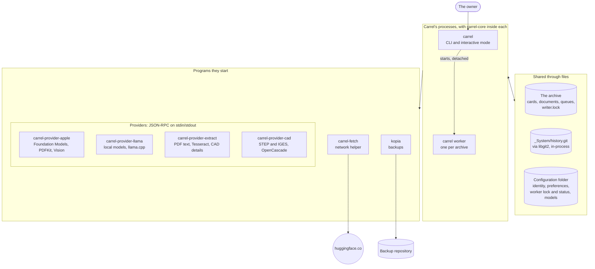
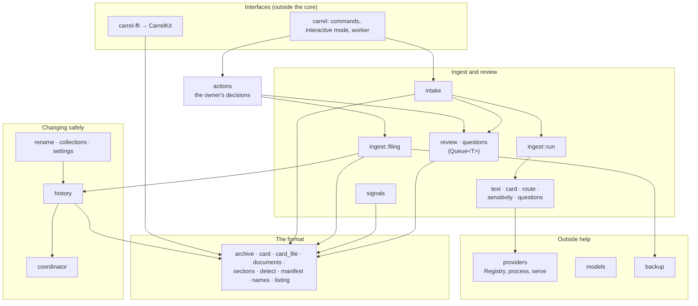
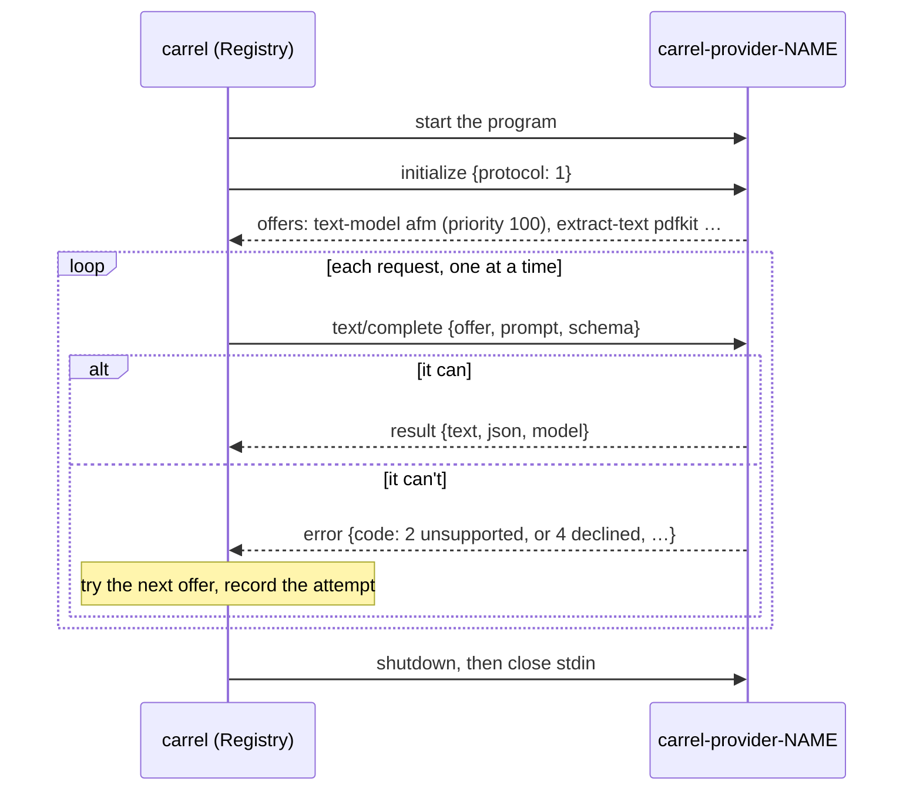
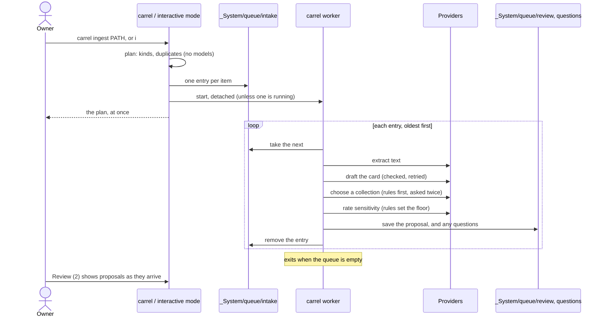
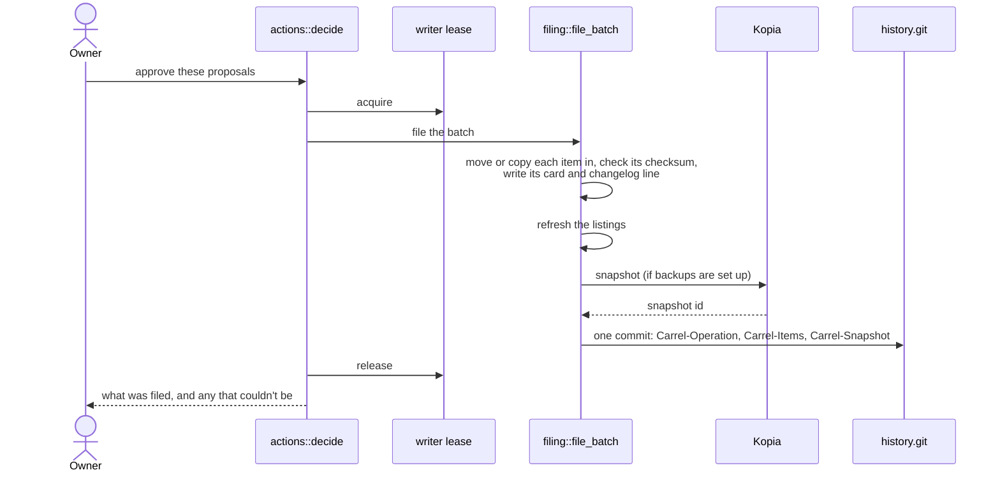

# Architecture

How Carrel is put together as of v0.2: the parts, what each does, how they talk to each other, and what they keep on disk. It's for anyone who wants to change Carrel. The [Code map](code-map.md) points from each part to the types and functions to read in the [code documentation](https://hrose.me/carrel/), and the [Overhead](overhead.md) page measures what splitting Carrel into separate programs costs.

What's planned but not built yet (the Mac app in v0.5, its background agent, iCloud sync through CloudKit in v2.0) is marked as such. The design spec and the [Roadmap](https://github.com/HannahARose/carrel/wiki/Roadmap) describe it.

## The shape of it

Later (v0.5), the SwiftUI app reaches the same core through CarrelKit (Swift) and `carrel-ffi` (UniFFI), without the CLI in between.

Three ideas run through it:

1. **One core, thin interfaces.** Everything about archives (the format, cards, history, ingest, review, filing, backups) is in the `carrel-core` library. The CLI, the interactive mode and later the Mac app present it; they hold no archive logic of their own.
2. **Separate programs for anything platform-specific, network-facing or heavy.** Models and text extraction come from provider programs, downloads from a network helper, backups from Kopia. Each can be native to its platform, swapped, or audited on its own.
3. **The archive is the source of truth, in plain files.** Queues, proposals, questions, settings and locks are files in the archive or the configuration folder, so any process, or a person, can read them, and a crash never loses more than the item in progress.

## The parts

| Part | Kind | What it does |
| --- | --- | --- |
| [`carrel-core`](https://hrose.me/carrel/carrel_core/) | Rust library | The archive format, cards, history, coordination, ingest, review, filing, backups, signals, the provider protocol's client and server sides, model downloads' checks. Builds for macOS, Linux, Windows and iOS; prints nothing and opens no network connection. |
| [`carrel`](https://hrose.me/carrel/carrel/) (`crates/carrel-cli`) | Program | The command-line tool, the interactive mode (`tui/`), the worker, and the benchmark. Each command returns a [`Report`](https://hrose.me/carrel/carrel/struct.Report.html) (text for people, JSON for scripts); `main` prints it. |
| `carrel worker` | Process of the same program | Drafts the intake queue, one item at a time, detached from the terminal. One per archive per device. |
| [`carrel-provider-llama`](https://github.com/HannahARose/carrel/tree/dev/crates/carrel-provider-llama) | Program | Text models: local GGUF models through llama.cpp, with Metal on Macs. |
| [`carrel-provider-extract`](https://hrose.me/carrel/carrel_provider_extract/) | Program | PDF text in Rust, OCR through Tesseract when it's installed, and what 3MF, G-code, STEP and IGES files say about themselves. |
| [`carrel-provider-cad`](https://github.com/HannahARose/carrel/tree/dev/crates/carrel-provider-cad) | Program, optional | STEP and IGES models meshed through OpenCascade and drawn by a software renderer, for an image reader to describe. Builds without OpenCascade, and then says how to install it. |
| `carrel-provider-apple` (`apple/CarrelProviders`) | Swift program | Apple's on-device model (Foundation Models), PDFKit and Vision. |
| [`carrel-fetch`](https://hrose.me/carrel/carrel_fetch/) | Program | The network helper: downloads models, and is the only Carrel program that goes online. |
| Kopia | Third-party program | Deduplicated, encrypted backups of file contents. |
| [`carrel-ffi`](https://hrose.me/carrel/carrel_ffi/), `apple/CarrelKit` | Rust library and Swift package | UniFFI bindings for the Mac and iOS apps (v0.5); today they create and open archives and list collections and items. |
| `apple/CarrelApp` | Xcode project | The Mac app (v0.5), over CarrelKit. |

### Inside the core

The core's modules fall into five groups. The [Code map](code-map.md) lists the main type or function in each.

- **The format:** `archive` (create and open), `card` and `card_file` (frontmatter and body), `frontmatter`, `documents` (`ARCHIVE.md`, `_collection.md`, `settings.json`), `sections` (the managed parts of a body), `detect` (item kinds, sealing), `manifest` (checksums), `names` (portable names), `listing` (generated contents lists).
- **Changing the archive safely:** `coordinator` (the writer lease), `history` (commits and undo), and the operations built on them: `rename`, `collections`, `settings`.
- **Ingest and review:** `ingest` and its stages (`text`, `card`, `route`, `sensitivity`, `questions`, `run`, `filing`), `intake` (the queue), `review` and `questions` (their queues), `actions` (the owner's decisions, shared by every interface), `signals`.
- **Outside help:** `providers` (the registry, the protocol client in `providers::process`, and the server helper in `providers::serve`), `models` (the catalog and checked downloads), `backup` (the `Backups` trait and Kopia).
- **This device:** `local` (where the configuration and models folders are).

How the groups depend on each other. Arrows point from a module to what it uses; nothing in the format layer knows about ingest or providers.

## How the parts communicate

### 1. In-process calls

The CLI calls the core as a library. Commands in `crates/carrel-cli/src` turn arguments into core calls and results into a `Report`. The interactive mode doesn't reimplement commands: it calls the same functions (`crate::review::approve`, `crate::ingest::change_queued`, …), so it reports exactly what the commands would. The core's decisions that every interface shares, such as approving, moving or answering, are in [`actions`](https://hrose.me/carrel/carrel_core/actions/), so the Mac app will reuse them too.

### 2. Providers: JSON-RPC over standard input and output

Specified in [docs/providers.md](../providers.md). In short:

- A provider is any program named `carrel-provider-NAME`, found beside `carrel` or on `PATH`. Carrel starts it, sends `initialize`, and gets its **offers**: each capability it has (`text-model`, `extract-text`), a priority (100 for native tools, 50 for portable ones, 10 for built-ins) and whether it's available now.
- Requests (`text/complete`, `text/count-tokens`, `text/extract`) are JSON-RPC 2.0, one line each, one at a time. Standard error is the provider's log; Carrel keeps the last lines for error messages.
- Errors carry a code: 1 unavailable, 2 unsupported, 3 failed, 4 declined (a safety refusal). The [`Registry`](https://hrose.me/carrel/carrel_core/providers/struct.Registry.html) ranks offers by priority (or the owner's choice), tries the next on any error, and records each attempt; cards record which model produced their fields.
- Timeouts: 10 seconds to initialize, 10 minutes a request.
- [`providers::serve`](https://hrose.me/carrel/carrel_core/providers/serve/fn.serve.html) is the other end, used by the Rust providers; a provider in another language just speaks the protocol (the Apple one is Swift). `crates/carrel-core/examples/echo_provider.rs` is a complete one in about 100 lines.

A provider program lives as long as the process that started it, so a model stays loaded between items.

### 3. The network helper: one request, a stream of events

[`models::download`](https://hrose.me/carrel/carrel_core/models/fn.download.html) starts `carrel-fetch` with one [`FetchRequest`](https://hrose.me/carrel/carrel_core/models/struct.FetchRequest.html) on standard input (URL, allowed hosts, size, SHA-256, destination, log) and reads [`FetchEvent`](https://hrose.me/carrel/carrel_core/models/enum.FetchEvent.html) lines (progress, done, failed). The helper refuses hosts not on the list, resumes partial files, hashes as it writes, and logs every request. The core then hashes the file again itself before giving it the name the provider looks for. `cargo deny` keeps HTTP clients out of every other crate (`deny.toml`).

### 4. Kopia: a program with JSON output

[`backup::Kopia`](https://hrose.me/carrel/carrel_core/backup/struct.Kopia.html) runs `kopia` with a configuration file per archive on this device, and reads its JSON output. The repository password is kept in the system keychain by Kopia, never in the archive. Filing a batch takes a snapshot, pinned so retention never removes it, and names it in the history commit.

### 5. History: Git, in-process

[`history::History`](https://hrose.me/carrel/carrel_core/history/struct.History.html) uses libgit2 on `_System/history.git`, tracking exactly the metadata files (cards, documents, `_System`), never item contents. Each change is one commit with trailers: `Carrel-Operation`, `Carrel-Items`, and `Carrel-Snapshot` when a backup was taken. Undo is a new commit that reverses one, moving files back where it has to.

### 6. Files, between Carrel's own processes

Carrel's processes don't talk over sockets. They share files:

| File | Written by | Read by | Purpose |
| --- | --- | --- | --- |
| `_System/queue/intake/*.json` | `carrel ingest`, the interactive mode | the worker, `--status`, the Ingest screen | Items waiting to be drafted |
| `_System/queue/review/*.json` | the worker | review, the interactive mode | Proposals |
| `_System/queue/questions/*.json` | the worker | questions, the interactive mode | Questions for the owner |
| `_System/writer.lock` | whoever writes the archive | everyone | The **writer lease**: one writer at a time, with an expiry renewed while it works |
| `workers/ARCHIVE.lock` (configuration folder) | the worker | `carrel ingest`, the interactive mode | One worker per archive per device, through an operating-system file lock that dies with the process |
| `workers/ARCHIVE.json`, `.log` | the worker | `--status`, the interactive mode (about once a second) | What the worker is doing |

Queue entries record the device they belong to, since only that device has the files. That's what will let several devices share an archive later.

## What's on disk

**In the archive** (specified in [FORMAT.md](../../FORMAT.md)): items with cards beside them, collections with design documents and changelogs, `ARCHIVE.md`, `Holding/`, and `_System/`: `archive.json` (identity), `settings.json`, `glossary.md`, `rules/`, `queue/`, `manifests/`, `history.git/`, `writer.lock`, and a copy of FORMAT.md.

**On this device** (`carrel_core::local::config_dir()`): `identity.json`, `cli.json`, `models/`, `workers/`, `backups/`, `logs/`. See the [User guide](../guide/user-guide.md#what-carrel-keeps-on-this-device).

## The main flows

### Ingest: from a path to a proposal

1. `carrel ingest PATH` or the interactive mode calls [`intake::add`](https://hrose.me/carrel/carrel_core/intake/fn.add.html): **plan** the paths ([`ingest::plan`](https://hrose.me/carrel/carrel_core/ingest/fn.plan.html): intake, kind, fingerprint, duplicates against a checksum index), skip what's queued or proposed, and write one intake entry per item.
2. [`worker::start`](https://hrose.me/carrel/carrel/worker/fn.start.html) launches `carrel worker` detached, unless one holds the lock.
3. The worker ([`worker::work`](https://hrose.me/carrel/carrel/worker/fn.work.html)) starts the providers once, then for each entry calls [`intake::process`](https://hrose.me/carrel/carrel_core/intake/fn.process.html), which runs [`run_with_progress`](https://hrose.me/carrel/carrel_core/ingest/run/fn.run_with_progress.html) on that one item:
   - **text** ([`ingest::text::read`](https://hrose.me/carrel/carrel_core/ingest/text/fn.read.html)): the best extractor, trimmed of back matter and fitted to the model's context;
   - **card** ([`ingest::card::draft`](https://hrose.me/carrel/carrel_core/ingest/card/fn.draft.html)): a model drafts it against a JSON Schema, then checks; a failed check is retried with the problems stated, then the next model;
   - **route** ([`Router`](https://hrose.me/carrel/carrel_core/ingest/route/struct.Router.html)): rules first, then the model level by level with design documents as context, asked twice;
   - **sensitivity** ([`assess`](https://hrose.me/carrel/carrel_core/ingest/sensitivity/fn.assess.html)): the rule floor, then the model, which may only raise it;
   - **propose**: a review entry, saved at once.
4. Questions are recomputed across all open proposals ([`intake::ask_with_waiting`](https://hrose.me/carrel/carrel_core/intake/fn.ask_with_waiting.html)); an owner rule with `auto_file` files its item straight away; the intake entry is removed.

### Approval: from a proposal to a filed item

[`actions::decide`](https://hrose.me/carrel/carrel_core/actions/fn.decide.html) takes the writer lease and calls [`filing::file_batch`](https://hrose.me/carrel/carrel_core/ingest/filing/fn.file_batch.html): each item is moved or copied in under a portable, free name, checked against its checksum, given its card and a changelog line; listings are refreshed; a backup snapshot is taken if one's set up; and the batch becomes one history commit naming the snapshot.

### Undo

[`History::undo`](https://hrose.me/carrel/carrel_core/history/struct.History.html#method.undo) reads the change's tree and its parent's, moves items back, restores the metadata files, and commits the reversal. Undoing the history's first change is refused.

## Concurrency and failure

- **Writing the archive** needs the writer lease ([`DiskLock`](https://hrose.me/carrel/carrel_core/coordinator/struct.DiskLock.html), [`WriterLease`](https://hrose.me/carrel/carrel_core/coordinator/struct.WriterLease.html)): filing, undo, renames, new collections, settings. Only the lease holder may commit history. Reading needs nothing.
- **The worker doesn't hold the lease while drafting**; drafting only writes queue files. It takes the lease briefly only when a rule files an item.
- **A crash** loses at most the item being drafted: its intake entry stays and is drafted again. A crash in the moment between saving a proposal and removing its entry would leave the entry to be drafted a second time, giving two proposals for one item; rejecting the extra one is safe.
- **Two devices** on one archive need a coordinator other than the lock file; the CLI warns in synced folders until CloudKit's lock arrives (v2.0).

## Where to add things

| To add | Start with |
| --- | --- |
| A provider | [docs/providers.md](../providers.md), `providers::serve`, and `examples/echo_provider.rs`. Name it `carrel-provider-NAME`. |
| A command | A function returning `Result<Report, Failure>` in `crates/carrel-cli/src`, a `Command` variant in `main.rs`, and a test in `crates/carrel-cli/tests/cli.rs`. Put any archive logic in the core. |
| A screen in the interactive mode | A `Tab` and keys in `tui/app.rs`, an `Effect` for anything that writes, drawing in `tui/ui.rs`, and a test in `tui/mod.rs` with ratatui's `TestBackend`. |
| A field in the format | FORMAT.md first (and its copy in `fixtures/sample-archive/_System/`), then the type, then regenerate the schema with `UPDATE_SCHEMAS=1 cargo test -p carrel-core --test cards`. |
| A bigger feature | A design document in `docs/design/`, accepted before building, as the existing ones were. |

## Testing and CI

`cargo test --workspace` runs everything that doesn't need a model or Kopia. CI (`.github/workflows/ci.yml`) runs format, clippy (pedantic, as errors), tests on macOS, Linux and Windows, docs, the Swift package, the llama.cpp provider against a tiny model, the CAD provider with OpenCascade on macOS and Linux, Kopia against a throwaway repository, extraction with Tesseract, `cargo deny`, zizmor on the workflows, and spelling, Markdown and link checks; "CI passed" gates merging. `fixtures/sample-archive` is a hand-built archive checked against the format on every run. `carrel bench` measures models on `fixtures/bench` ([docs/design/benchmark.md](../design/benchmark.md)). See [CONTRIBUTING.md](../../CONTRIBUTING.md) for branches, reviews and releases.
