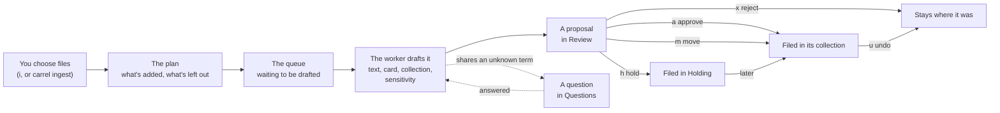

# User guide

How Carrel works, and how to use each part of it. If you haven't used Carrel yet, start with [Getting started](getting-started.md); every command and key is in [Commands](commands.md).

## The archive

An archive is an ordinary folder. Everything in it is readable without Carrel: in Finder, in a text editor, or as an [Obsidian](https://obsidian.md) vault. Carrel's own data lives in `_System/`.

```text
Archive/
  ARCHIVE.md                 what the archive is, and links to every collection
  Holding/                   items waiting for a home
  Receipts/
    _collection.md           the design document: what belongs here
    CHANGELOG.md             what was filed here, and when
    laptop invoice.pdf       an item
    laptop invoice.pdf.md    its card
  _System/                   settings, rules, the glossary, queues, history, manifests
```

The precise layout is the archive format, specified in [FORMAT.md](../../FORMAT.md). It's meant to outlast Carrel.

### Items and cards

An **item** is one thing in the archive, with a **card** beside it named after it (`laptop invoice.pdf.md`). The card is Markdown: frontmatter that Carrel writes (title, summary, tags, dates, sensitivity, checksum), and a body that's yours to write in. Carrel never changes your text.

An item can be:

- a **file**;
- an **open folder**, kept together, whose contents you may reorganize;
- a **bundle**, a folder stored and moved whole, such as a code repository (anything with `.git`, `Cargo.toml`, `package.json` and the like) or an app project, which Carrel never looks inside;
- something not in the archive at all, with only a card: a **physical** object such as a book, a **URL**, or an **external** file on another disk.

Folders like `node_modules` or `target` inside a bundle are **regenerable**: noted, kept out of backups, never deleted.

### Collections and design documents

A **collection** is a folder with a **design document**, `_collection.md`, saying what belongs in it. Collections can hold subcollections (`Finances/Tax`). Create one with `carrel collection new NAME --description "…"`, then edit its document:

- **Purpose and scope:** what belongs here.
- **Not here:** what looks as if it belongs but doesn't, and where it goes instead.
- **Organization:** how it's arranged, for example "flat until a topic has five items".

Models read Purpose and scope, and Not here, before filing anything, so these are how you teach Carrel your structure. A collection's frontmatter can also list **tags** with what each means; cards only use tags defined along their path.

**Holding** is the collection for items that don't fit anywhere yet. It isn't a failure: it's where Carrel puts what it shouldn't guess about.

## Adding files: ingest

Ingest is how files come into the archive. It never moves anything until you approve, and on approval it moves the original in, unless you set originals to be kept (see [Settings](#settings)).

1. **Choose files:** `i` in the interactive mode (with your file picker or the built-in browser), or `carrel ingest PATH...` in the shell. A folder is one item, unless you ask for each entry (`--each`, or `e` in the plan). A folder named like a pile (Downloads, Desktop, Inbox) makes you choose.
2. **The plan** shows what will be added, its kind and size, and what's left out: duplicates of items already in the archive or of each other, items already waiting for review, files your rules ignore. `--dry-run` shows only the plan.
3. **The queue:** each item waits in `_System/queue/intake/` until a **worker** drafts it. The worker runs in the background, one item at a time, and keeps going after you close the terminal. If it's stopped, it picks up where it left off the next time anything is added (or when you run `carrel worker`). `carrel ingest --status`, or the interactive mode's Ingest screen, shows what's waiting and what failed.
4. **Drafting each item:** the worker reads the item's text (PDF text, OCR for scans, for images what they show, and for 3D models their shape; see [Images](#images) and [3D models and CAD files](#3d-models-and-cad-files)), drafts its card with a model (title, summary, tags, dates), chooses a collection, and rates how sensitive it is. The proposal is saved as soon as it's ready, and appears in Review.

An item's journey:



### How Carrel chooses a collection

- **Your rules first.** `_System/rules/routing.yaml` lists rules that match by extension, name, a marker file or the folder an item came from, and name a collection. The first that matches decides, before any model is asked. A rule with `auto_file: true` files its matches without review, except anything sensitive.
- **Then the model**, one level at a time: it sees the top-level collections' design documents and the draft card, picks one, says how well it fits, and goes down into subcollections. It's asked twice, and the two answers must agree.
- **A second opinion** when the model isn't sure: an item it would send to Holding, or place with low confidence, is routed again by a second model, and the better answer is kept, with both models' reasons. By default the second model is a recommended one you've installed (`carrel models`), so a fast model such as Apple's can file most items and a more careful one looks at the rest. Choose another with `carrel settings set second_model NAME`, or turn it off with `off`.
- **Confidence:** *high* when a rule decided, *medium* when the model's two answers agreed, *low* otherwise. Poor or uncertain fits go to Holding.

When an item is filed with low or medium confidence, its card keeps a `placement` record of that. `carrel status` gathers these into **Structure** signals: many uncertain items in one collection, a crowded collection, a collection with a single item, a tag used across several collections, or a lot waiting in Holding. They're hints that the structure could change; nothing moves until you decide.

### Sensitivity

Every item is rated **public**, **personal**, **sensitive** or **restricted**:

- Rules set a floor before any model: a card number (in a card's format, with a real issuer's prefix and check digit), a bank account number (IBAN), a social security number, a private key, a written-down password or account recovery codes make it **restricted**; words like "diagnosis", "payslip", "tax return" or "insurance claim" make it at least **sensitive**.
- A photo that records where it was taken is at least **personal**, with the reason "has the place it was taken". Most phone photos have a location, so it never raises them further.
- A model may raise the level to **sensitive**, never lower it. Only the rules make an item restricted, since they check the value itself, and a file with no readable text isn't rated by a model at all.
- The archive sets a default, **personal**.

Sensitive and restricted items always wait for your approval, whatever rules say. The reasons are given in words, never by quoting what was found.

### Images

On a Mac, Carrel reads more of an image than its text. For each picture it notes:

- what kind it is (a photo, a screenshot or another image), its size, when it was taken, and the camera or app that made it;
- a few labels from Apple's Vision framework, such as `document`, `dog` or `beach`;
- any text in it, by OCR;
- on macOS 27 with Apple Intelligence, a sentence or two from Apple's on-device model on what it shows.

The model drafts the card from all of that, so a photo named `IMG_0550.jpeg` gets a real title. When the model gives no date, the date the photo was taken becomes the card's **created** date. Where a photo was taken is never written into the text or the card; Carrel only notes that it has a location. Everything is read on the device.

### 3D models and CAD files

A model's file name often says little (`part_v3_final.stl`), so Carrel looks at the model itself.

- **STL, OBJ, PLY and USD/USDZ, on a Mac:** Carrel measures the model (its size, as stored, usually in millimetres; its triangles; how many separate parts it has) and draws it from four sides. On macOS 27 with Apple Intelligence, Apple's on-device model says what the drawings show, such as "a ring-shaped component, likely a seal". It isn't told the file's name, so it looks rather than guesses from the name; the card is drafted from the name and the description together.
- **3MF, G-code, STEP and IGES, on any platform:** Carrel reads what the file says about itself, without drawing it:
  - a 3MF's title, designer, description and license, the printer and filament, and its objects
  - the slicer's notes in G-code: the printer, filament, layer height, print time, and the objects printed
  - a STEP or IGES file's name, the program that exported it and when, its author and organisation, and a STEP file's part names
- **Drawing STEP and IGES:** with the optional `cad` provider, which needs [OpenCascade](https://dev.opencascade.org), Carrel also measures a STEP or IGES model (its size in millimetres, how many solids, their volume) and draws it from four sides for an image reader to describe, as for STL.
- **Dates:** when the model gives none, the date the file was exported becomes the card's **created** date.
- **Thumbnails:** a 3MF's thumbnail is described like an image on a Mac. The drawings and thumbnails aren't kept.

### Correcting a card

When a card is wrong, say what's wrong: `c` on a proposal in Review or on an item in Browse, or `carrel review correct ID "…"` and `carrel correct ITEM "…"`.

- **Narrow or broad.** "It's from 2019, not 2025" changes the date. "This is a picture of Lake Annecy, not Geneva" changes what the item is, so the title, summary and tags follow, and the item is routed again: a proposal moves, and a filed item is refiled.
- **You see it first.** Each change is shown before and after, with the values you stated marked "(yours)". Nothing is saved until you agree.
- **Or edit it yourself:** `e` in Browse, or `carrel edit ITEM`, opens the card's fields in your editor, the same way `e` does for a proposal in Review. Delete a line to clear it.
- **Exact fixes without a model:** lines like `created: 2019-03-31`, `tags: +housing -bank`, `sensitivity: personal`, `collection: Home` or `title: …` are applied as written.
- **Your word goes, with one safeguard.** You can lower the sensitivity, choose any collection, and set any field. An item where a rule found a card number, account number, key, password or recovery codes stays at least sensitive.
- **It sticks.** Fields you stated outright stop being marked as model-written, so later model work never overwrites them. Fields the model worked out from a broad correction stay model-written, but the correction is kept with the card, so a later re-check can't undo it. Each correction is one change in history, with your words, and `carrel undo` reverses it.
- **Lasting facts.** When a correction says something true beyond the item ("Acme Property is my landlord"), Carrel offers to add it to the glossary.

### Zips and other compressed files

A zip is usually a folder someone packed up to send. Carrel unpacks it, so you can see and search what it holds in Finder, Obsidian and Carrel. This applies to zip, tar, gzip, bzip2, xz and zstd files, and to 7z and RAR when 7-Zip or `unar` is installed.

- **Drafting reads inside without unpacking.** It looks at the list of files, the README, and project files such as `Cargo.toml`, so the card and collection come from what's in it, as for a folder. A zip holding one document, such as `report.pdf.zip`, is read as that document.
- **Review shows the plan.** For example, "will be expanded: 440 files, 1.8 GB, into Projects/Lab/Spectrometer export", or "kept compressed: it holds an installer".
- **Nothing is unpacked until you approve.** Then what it held is filed in its place:
  - one file inside becomes that file
  - one folder wrapping everything becomes that folder
  - anything else becomes a folder named after the zip

  Modification times and execute permissions are kept, and `__MACOSX`, `.DS_Store` and `._` files are left out. The card records the zip it came from (`expanded_from`). The zip goes to the Trash once every file has been checked against it, so you can still get it back.
- **What's kept compressed, and why:**
  - software: an app, an installer (`.pkg`, `.dmg`, `.exe`, `.msi`) or anything with a code signature
  - encrypted archives (Carrel never asks for passwords)
  - archives split into parts
  - anything nothing on this device can open, which is listed in `carrel formats`
- **What Carrel asks about:** an archive that would unpack to more than ten times its size and over 1 GB, holds more than 100,000 files, or has paths that would land outside its folder.
- **Your choice:**
  - for one proposal: `z` in Review, or `carrel review expand ID` and `carrel review keep-compressed ID`
  - for a collection: `compressed_files: keep` in its `_collection.md`
  - for a routing rule: `keep_compressed: true`
  - for the whole archive: the `compressed_files` setting
- **Already filed?** `carrel expand ITEM` unpacks a compressed item with the same checks, as one change. `carrel undo` reverses it; then put the zip back from the Trash.

Documents that are zip files inside, such as `.docx`, `.xlsx`, `.epub` or `.jar`, are never unpacked.

### When a model declines

Apple's on-device model has safety filters that sometimes refuse documents, often medical or financial ones. When that happens, Carrel tries the next model it has. The proposal says which model declined and whether another stepped in; if none could draft the card, you write it yourself (`e` in Review). Downloading a local model with `carrel models` gives Carrel one to fall back on.

## Reviewing

Review is where proposals become filed items. In the interactive mode (`2`), each proposal shows the card it would write, the destination with its confidence and reasons, its sensitivity and why, and anything left to settle.

| Decision | Key | Command |
| --- | --- | --- |
| File it where proposed | `a` | `carrel review approve ID` |
| Choose another collection | `m` | `carrel review move-to ID COLLECTION` |
| Unpack a zip, or keep it compressed | `z` | `carrel review expand ID`, `carrel review keep-compressed ID` |
| Change the card first | `e` | `carrel review edit ID` |
| File it in Holding | `h` | `carrel review hold ID` |
| Leave the file where it is | `x` | `carrel review reject ID` |

Mark several with `Space` to decide them together, or approve every high-confidence, non-sensitive proposal with `A`. Each batch you approve is one change in history, with one backup snapshot.

### Duplicates

A proposal marked **duplicate** has the same checksum as an archived item: it's byte-for-byte the same. One marked **likely duplicate** isn't, but looks like the same thing arriving again:

- **same file name:** the names match once copy marks such as `(1)` and `copy` are ignored;
- **looks like a newer (or older) version:** the names match apart from a version marker, such as `v2`, `rev 4`, `draft 3`, `final` or a trailing date;
- **same title and date:** the drafted card's title and date match an archived card's.

The Review screen shows the proposal beside the archived item, with the rows that differ highlighted; `[` and `]` switch between matches when there are several. Then:

| Decision | Key | Command |
| --- | --- | --- |
| File it as a new version, linked with `version-of` | `v` | `carrel review approve ID --as-version-of ITEM` |
| Keep both, linked with `related` | `b` | `carrel review approve ID --related-to ITEM` |
| Skip it: the file stays where it is | `s` | `carrel review reject ID` |

`ITEM` is the archived item's identifier, or its start or end, and can be left out when there's only one match. Approving with `a` files a newer version as a version and anything else without a link. `A` never approves a duplicate or a likely one. Both versions stay in the archive; Carrel doesn't replace the archived item.

Editing opens the card's fields in your editor. When you save, Carrel checks them (tags from the vocabulary, real dates, a title) and reopens the file with any problems listed, until it checks out or you leave it unchanged.

## Questions and the glossary

When several items share something Carrel doesn't know, such as a project's code name in their file names, it asks one question instead of guessing on each. Questions wait on the Questions screen (`4`), the most useful first.

- **A term** ("What is “scope-ds”?"): answer in a sentence. Carrel saves it to `_System/glossary.md`, which every model reads from then on, and puts the waiting items back at the front of the queue, so the worker drafts them again with what you said.
- **A collection** ("Which collection do items about … belong in?"): choose one, and the waiting items move there.

Items waiting on a question aren't approved in bulk until it's answered or dismissed.

## Finding things

- `carrel search WORDS` finds items by what's in their cards and their contents (below).
- **Browse** (`5`) lists collections and their items, with each card in full. `/` searches titles, tags and summaries across the archive.
- **An item's view:** below its card, Browse lists every change that touched the item, newest first, from its filing to its latest correction or return, and the items its card links to (`version-of`, `related`, `part-of`). `Enter` on an item moves into its view: `u` undoes the chosen change (after asking, as History does), `Enter` on a linked item goes to it, and `←` or `Esc` go back.
- **Recent**, on the Status screen (`1`) and in `carrel status`, lists the last ten things filed, changed or worked on across the archive: each recorded change, and each approved work session on the day it happened.
- `carrel show ITEM` prints a card, its links, and the changes that touched it, each with the identifier `carrel undo` takes.
- `ARCHIVE.md` and each collection's design document end with a generated list of its contents, so the archive is browsable in Finder or Obsidian too.

### Searching

`carrel search` looks for your words in every card (title, summary, tags, collection, dates and your own notes on it), in each item's text (what drafting read: a PDF's text, a scan's recognized text, a folder's README and listing), in the collections' design documents, and in the glossary. Exact names, numbers and codes work: `carrel search invoice 2057-4038` finds the invoice with that number even when its card doesn't mention it. Plurals don't matter ("receipts" finds "receipt"), and a code like `2057-4038` matches whole first.

Results come best first, each with its title, collection, date and kind, a mark for **[sensitive]** and **[restricted]** items, the passage that matched with your words in bold, and what matched (`title`, `summary`, `tags`, `notes`, `text` and so on). `--limit N` shows more or fewer than 20.

Filters narrow the items found, and can be used with words or alone:

| Filter | Finds items |
| --- | --- |
| `collection:Finances` | In that collection or one inside it, by path (`Projects/Hardware`) or name (`Hardware`) |
| `tag:receipts` | With that tag |
| `kind:folder` | Of that kind: `file`, `folder`, `bundle`, `physical`, `url`, `external` (and `tombstone` for removed items, which are otherwise left out) |
| `after:2025-01` | Dated in that year, month or day or later: the document's date, else when it was made, else when it was added |
| `before:2026` | Dated before that year, month or day |
| `sensitivity:sensitive` | At that level |
| `checked-out` | Checked out now |

A value with spaces goes in quotes: `collection:"Tax returns"`. `carrel search tag:receipts after:2025` lists every receipt since 2025, newest first.

**Restricted items are found by their card only, never by their text**, so a card number or password inside one can't be searched for. Their text isn't kept for search at all. Sensitive items are searched like any other; the results are only ever shown to you.

The first search reads the text of items that haven't been read yet, with a progress bar. Text is kept in `_System/cache.nosync/text/`, one file per item's contents, so each item is read once; drafting keeps the text it reads there too. It's a cache: left out of history, backups and sync, and safe to delete. A file nothing on this device can read is tried again a week later, in case a provider that reads it has been added. Search by meaning, so that "the lease for the flat" finds a tenancy agreement, follows in a later version.

## Working on items

Most items are filed and left alone, but some are still being worked on: a project, a thesis, a manuscript. Carrel keeps track of the work without getting in its way.

- **Checking out** copies an item out of the archive to work on, to the Desktop unless you say where: `carrel checkout ITEM [--to FOLDER] [--due DATE]`. The archive copy is read-only until it comes back, and the card records where it went and when. On a Mac, the working copy has a “Checked Out” tag in Finder while it's out; returning or cancelling takes it off and leaves your own tags alone.
- **Returning** brings the working copy back: `carrel return ITEM` shows what changed and the history entry it adds, and asks first. A backup snapshot is taken, and the change can be undone from History. `--discard` cancels the checkout instead, leaving the archive copy as it was.
- **The desk** is for things you work on where they are, without archiving them yet: `carrel desk add PATH` writes a card beside the file or folder, drafted by your text model as ingest would, and nothing inside it is changed or moved. When it's done, `carrel desk archive PATH` queues it for ingest: you review its proposal as usual, and the card it had on the desk, history and all, goes into the archive with it. `carrel status` suggests folders on your Desktop or in `~/Code` that look like work in progress, and desk items you haven't touched for 60 days.
- **Work sessions:** Carrel notices work on checked-out and desk items and adds a pending history entry for each finished stretch of it; see [Work sessions](#work-sessions). Approve, edit, combine or drop them with `carrel sessions`, or on the Active screen.

The **Active** screen (`3`) lists what's checked out and what's on this device's desk, each with its pending entries under it. The chosen item's details are on the right: where the working copy is, when it was checked out and is due, what has changed, and its pending entries, numbered.

- `r` returns the chosen checkout, after showing what changed; `x` cancels it, after asking.
- `o` opens the working copy (or the desk item) in Finder, or in the app its type opens with, and leaves the interactive mode as it is.
- `a`, `c` and `d` approve, combine or drop the chosen item's pending entries: all of them, or the ones marked with `Space`.
- `e` opens the chosen pending entry's text in your editor (`$VISUAL` or `$EDITOR`), as `e` in Review does. It stays pending until you approve it.

Active/ in the archive, and the Journal, show the same in Obsidian, and are kept current with every checkout, return and approved entry. `Active/On desk/` has a copy of each desk item's card, so you can read and annotate it with the rest of the archive: notes you write there, outside the box at the top and the history, are copied to the card beside the item the next time you run `carrel desk` or change the desk.

### Work sessions

Carrel notices work on checked-out and desk items from what's on disk: each file's modification time, and a Git repository's commits. Changes closer together than `sessions.idle_minutes` (45 by default) are one **session**, and each finished session becomes a pending entry in the card's history, with the files changed, the commits and the time spent. A session still going isn't written until it's over.

Carrel looks for sessions whenever it runs, at most every five minutes: before each command that changes the archive, and in the background while the interactive mode is open. It never waits for another program that's writing to the archive; it looks the next time. `carrel sessions` looks right away and lists the pending entries; `carrel sessions approve ITEM`, `edit`, `combine` or `drop` decide them. `carrel sessions edit ITEM N` opens entry `N`'s text in your editor; it stays pending, and anything you add is kept when entries are combined (a line starting `My notes:` goes last).

You can also approve an entry in Obsidian: change `> [!pending] 2026-10-29 · 2h 10m · auto-generated` to a heading, `### 2026-10-29 · 2h 10m`, and take the `>` marks off its lines, or change `pending` to another callout type such as `done`. The next time Carrel looks, it notices, adds the entry to the Journal and records the approval in History, leaving the entry exactly as you wrote it. Until the Mac app watches items live, a file changed and then changed back isn't seen.

When backups are set up, each time Carrel finds finished sessions on an item it also takes a snapshot of the working copy, so work in progress is backed up before it's returned. That's the state when Carrel noticed, which for most work is the state when the session ended. For large data, such as a 60 GB dataset, add `snapshots: return-only` to the card to skip these and keep only the checkout and return snapshots.

Returning an item lists its session snapshots. Once the item is back, Carrel snapshots the returned version and asks whether to forget the session snapshots, keeping the return's; `--trim-snapshots` forgets them without asking. Without an answer, as with only `--yes`, they're kept: deleting backups is your call.

## History and undo

Every change Carrel makes to the archive is recorded: filing a batch, renaming, creating a collection, changing a shared setting, answering a term question. History is a Git repository in `_System/history.git` holding the cards and documents, not the files themselves (backups have those).

- **History** (`6`) or `carrel log` lists changes, newest first.
- `u` on a change, or `carrel undo CHANGE`, reverses it with a new change: files it moved go back, and cards and documents return to how they were. The change that created the history can't be undone.
- Rejecting a proposal isn't a change to the archive, so it isn't undone this way; ingest the file again instead.

### Writing safely

Only one program changes an archive at a time: it holds the **writer lock** (`_System/writer.lock`) while it writes, and `carrel status` shows who holds it. A lock file is only safe while one device uses the archive, so Carrel warns when the archive is in iCloud Drive, Dropbox, OneDrive or Google Drive. Syncing between devices comes with the Mac app's CloudKit lock (v2.0).

### Names that work everywhere

`carrel status` lists names that won't work on every system: characters Windows forbids (`: ? * |`), reserved names like `CON`, trailing dots or spaces, or two names that differ only in case. `carrel rename ITEM` renames an item and its card to the suggested portable name, and updates links to it. Ingest files new items under portable names automatically.

## Backups

History keeps the cards; [Kopia](https://kopia.io) keeps the files. After `carrel backup setup PATH` (an external drive is safest; a synced folder is refused), each approved batch takes a snapshot, and its history entry names it.

- `carrel backup list` shows snapshots with the change each belongs to.
- `carrel backup verify` checks the repository, reading back a sample of the files.
- `carrel backup restore ITEM [--at CHANGE]` restores an item as it was, into a new folder beside the archive. It never overwrites anything.
- The password is asked for once and kept in your keychain. Losing it means losing the backups, so keep it in a password manager too.
- The interactive mode's Backups screen (`9`) does the same: it lists the snapshots with their changes (from history, so it works with the drive unplugged), and `n` takes a snapshot, `v` verifies, `r` restores an item as of the chosen snapshot, and `s` sets up or connects a repository: choose its folder with your file picker or the built-in browser (`/` to type a path), then type the password, shown as dots.

If the backup drive isn't connected, filing still works; the next snapshot covers what was missed.

Snapshots of checked-out and desk items' working copies ([Work sessions](#work-sessions)) are kept in the same repository, but `carrel backup list` shows only the archive's.

## Models and providers

Carrel never sends your files anywhere. Everything it does with them runs on your computer, through **providers**: separate programs that give Carrel text models and text extraction.

| Provider | What it gives Carrel | Where |
| --- | --- | --- |
| `apple` | Apple's on-device model, PDF text (PDFKit), images (ImageIO, Vision and Apple's model), 3D models (ModelIO, SceneKit and Apple's model), OCR (Vision) | Macs with Apple Intelligence |
| `mlx` | Open models you download, through Apple's MLX, usually faster than llama.cpp on the same Mac | Apple-silicon Macs with twice the model's size in memory |
| `llama` | Open models you download, through llama.cpp | Any platform |
| `extract` | PDF text, the details of 3MF, G-code, STEP and IGES files, and OCR through [Tesseract](https://tesseract-ocr.github.io) if it's installed | Any platform |
| `cad` | STEP and IGES models measured and drawn through [OpenCascade](https://dev.opencascade.org); optional, built from source | Any platform with OpenCascade |

`carrel providers` shows what this device has and which is used for what; the best available is chosen, and the next is tried when one can't help. `carrel models` lists models you can download, with their size, the memory they need and their license, and marks the ones the benchmark recommends: Qwen3.5 4B for 8 GB of memory, Gemma 4 E4B for 16 GB or more ([results](../bench/README.md)). It downloads one only when you ask: `carrel models download NAME` for llama.cpp, or `--format mlx` for the MLX provider. An MLX model is loaded on its first request and unloaded after five idle minutes. `carrel formats` lists the file types this device reads, and the ones it couldn't: each device keeps a count of them by type and reason (no reader, the reader failed, or read but empty) in `unreadable.json` in Carrel's folder, without file names, so you can share it. An ingest that meets one says so. The only Carrel program that goes online is `carrel-fetch`, which downloads models and logs every request to `logs/network.log` on this device.

## Settings

The Settings screen (`8`), or `carrel settings`, shows two kinds:

**This device**, kept in `cli.json`:

- **File picker** for choosing what to ingest: yazi, lf, nnn, ranger, vifm or fzf if one's installed, any command you give (with `{out}` for the file it writes chosen paths to), or the built-in browser. Settings suggests pickers you could install; Carrel never installs anything.
- **Editor** for cards, before `$VISUAL` and `$EDITOR`.
- **Second model**, asked when the first isn't sure where an item goes: a model name, `off`, or `default` for a recommended model you've installed.
- **Model** that drafts cards, routes and rates items, as `provider/offer` (such as `llama/qwen3.5-4b`), or `default` to let Carrel choose: Apple's on-device model where there is one, then local models. If the chosen model isn't available, for example because its file was removed, Carrel uses the next best. `carrel settings` shows which is in use.

**This archive**, kept in `_System/settings.json` and shared by every device that opens it:

| Setting | Values | Default |
| --- | --- | --- |
| `ingest.originals` | `move` the original into the archive on approval, or `keep` it where it was and copy it in | `move` |
| `compressed_files` | `expand` zips and other compressed files on approval, `keep` them as they are, or `ask` in Review each time (see [Zips and other compressed files](#zips-and-other-compressed-files)) | `expand` |
| `signals.crowded_items` | How many loose items make a collection crowded | `30` |
| `outside_edits` | `flag` changes made outside Carrel for review, `reconcile` them as edits, or treat them as `drift` to undo. Stored now; it takes effect when Carrel starts watching for outside changes, in a later version | `flag` |

Changing an archive setting is a change in history, so it can be undone.

## What Carrel keeps on this device

Outside any archive, in `~/Library/Application Support/Carrel` on macOS, `%APPDATA%\Carrel` on Windows, or `~/.config/carrel` elsewhere (or `CARREL_CONFIG_DIR`):

| File | What it is |
| --- | --- |
| `identity.json` | This device's identifier and yours, recorded in every history change |
| `cli.json` | The archive chosen with `carrel open`, and this device's preferences |
| `models/` | Downloaded models (or `CARREL_MODELS_DIR`) |
| `workers/` | Each archive's worker lock, status and log |
| `backups/` | Kopia's configuration for each archive's repository |
| `sessions/` | When each archive's checked-out and desk items were last looked at for work sessions |
| `logs/network.log` | Every request `carrel-fetch` made |

## Troubleshooting

| What you see | What to do |
| --- | --- |
| "a text model" missing in `carrel providers` | Download one with `carrel models download NAME`, or turn on Apple Intelligence on a Mac |
| Nothing appears in Review after ingesting | `carrel ingest --status`: the worker may still be drafting, or an item may have failed (`--retry ID`) |
| "Still busy" in the interactive mode | Filing or answering is running; wait for the status line to clear |
| An item went to Holding | Move it in Review, or improve the collections' **Purpose and scope** and **Not here** so the next ones fit |
| "being changed by someone else" | Another program holds the writer lock; `carrel status` shows which |
| A scanned PDF has no text | Install Tesseract and Poppler (`brew install tesseract poppler`), or use the Apple provider on a Mac |
