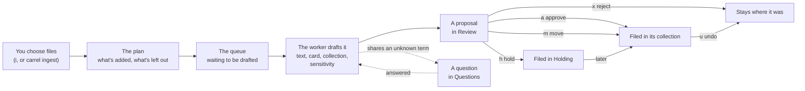

# User guide

How Carrel works, and how to use each part of it. If you haven't used Carrel yet, start with [Getting started](getting-started.md); every command and key is in [Commands](commands.md). The Mac app, its screens and its agent are in [The Mac app](mac-app.md).

`carrel tui` opens the interactive mode in the terminal (so does `carrel` alone), and `carrel gui` opens the Mac app on the same archive. Both take a screen to start on, by the same names: `carrel tui questions`, `carrel gui discover:wander` ([Commands](commands.md#the-interactive-mode)).

## The archive

An archive is an ordinary folder. Everything in it is readable without Carrel: in Finder, in a text editor, or as an [Obsidian](https://obsidian.md) vault. Carrel's own data lives in `_System/`.

```text
Archive/
  ARCHIVE.md                 what the archive is, and links to every collection
  Holding/                   items waiting for a home
  Receipts/
    _collection.md           the design document: what belongs here
    CHANGELOG.md             what was filed here, and when
    laptop invoice.pdf       an item
    laptop invoice.pdf.md    its card
  _System/                   settings, rules, the glossary, queues, history, manifests
```

The precise layout is the archive format, specified in [FORMAT.md](../../FORMAT.md). It's meant to outlast Carrel.

### Items and cards

An **item** is one thing in the archive, with a **card** beside it named after it (`laptop invoice.pdf.md`). The card is Markdown: frontmatter that Carrel writes (title, summary, tags, dates, sensitivity, checksum), and a body that's yours to write in. Carrel never changes your text.

An item can be:

- a **file**;
- an **open folder**, kept together, whose contents you may reorganize;
- a **bundle**, a folder stored and moved whole, such as a code repository (anything with `.git`, `Cargo.toml`, `package.json` and the like) or an app project, which Carrel never looks inside;
- something not in the archive at all, with only a card: a **physical** object such as a book, a **URL**, or an **external** file on another disk.

Folders like `node_modules` or `target` inside a bundle are **regenerable**: noted, kept out of backups, never deleted.

### Collections and design documents

A **collection** is a folder with a **design document**, `_collection.md`, saying what belongs in it. Collections can hold subcollections (`Finances/Tax`). Create one with `carrel collection new NAME --description "…"`, or `n` in Browse (`5`), which asks for its path, what belongs there and its tags; then edit its document:

- **Purpose and scope:** what belongs here.
- **Not here:** what looks as if it belongs but doesn't, and where it goes instead.
- **Organization:** how it's arranged, for example "flat until a topic has five items".

Models read Purpose and scope, and Not here, before filing anything, so these are how you teach Carrel your structure. A collection's frontmatter can also list **tags** with what each means; cards only use tags defined along their path.

**Holding** is the collection for items that don't fit anywhere yet. It isn't a failure: it's where Carrel puts what it shouldn't guess about.

## Adding files: ingest

Ingest is how files come into the archive. It never moves anything until you approve, and on approval it moves the original in, unless you set originals to be kept (see [Settings](#settings)).

1. **Choose files:** `i` in the interactive mode (with your file picker or the built-in browser), or `carrel ingest PATH...` in the shell. A folder is one item, unless you ask for each entry (`--each`, or `e` in the plan). A folder named like a pile (Downloads, Desktop, Inbox) makes you choose.
2. **The plan** shows what will be added, its kind and size, and what's left out: duplicates of items already in the archive or of each other, items already waiting for review, files your rules ignore. `--dry-run` shows only the plan.
3. **The queue:** each item waits in `_System/queue/intake/` until a **worker** drafts it. The worker runs in the background, one item at a time, and keeps going after you close the terminal. If it's stopped, it picks up where it left off the next time anything is added (or when you run `carrel worker`). `carrel ingest --status`, or the interactive mode's Ingest screen, shows what's waiting and what failed.
4. **Drafting each item:** the worker reads the item's text (PDF text, OCR for scans, for images what they show, and for 3D models their shape; see [Images](#images) and [3D models and CAD files](#3d-models-and-cad-files)), drafts its card with a model (title, summary, tags, dates), chooses a collection, and rates how sensitive it is. The proposal is saved as soon as it's ready, and appears in Review.

An item's journey:



### How Carrel chooses a collection

- **Your rules first.** `_System/rules/routing.yaml` lists rules that match by extension, name, a marker file or the folder an item came from, and name a collection. The first that matches decides, before any model is asked. A rule with `auto_file: true` files its matches without review, except anything sensitive.
- **Then the model**, one level at a time: it sees the top-level collections' design documents and the draft card, picks one, says how well it fits, and goes down into subcollections. It's asked twice, and the two answers must agree.
- **A second opinion** when the model isn't sure: an item it would send to Holding, or place with low confidence, is routed again by a second model, and the better answer is kept, with both models' reasons. By default the second model is a recommended one you've installed (`carrel models`), so a fast model such as Apple's can file most items and a more careful one looks at the rest. Choose another with `carrel settings set second_model NAME`, or turn it off with `off`.
- **Confidence:** *high* when a rule decided, *medium* when the model's two answers agreed, *low* otherwise. Poor or uncertain fits go to Holding.

When an item is filed with low or medium confidence, its card keeps a `placement` record of that. `carrel status` gathers these into **Structure** signals: many uncertain items in one collection, a crowded collection, a collection with a single item, a tag used across several collections, a lot waiting in Holding, items in two different branches that are often linked or worked on the same days (at least `min_collection_items` times), or sibling collections divided very differently, one into many small collections and the other hardly at all (four times as many items per collection). They're hints that the structure could change; nothing moves until you decide.

### Sensitivity

Every item is rated **public**, **personal**, **sensitive** or **restricted**:

- Rules set a floor before any model: a card number (in a card's format, with a real issuer's prefix and check digit), a bank account number (IBAN), a social security number, a private key, a written-down password or account recovery codes make it **restricted**; words like "diagnosis", "payslip", "tax return" or "insurance claim" make it at least **sensitive**.
- A photo that records where it was taken is at least **personal**, with the reason "has the place it was taken". Most phone photos have a location, so it never raises them further.
- A model may raise the level to **sensitive**, never lower it. Only the rules make an item restricted, since they check the value itself, and a file with no readable text isn't rated by a model at all.
- The archive sets a default, **personal**.

Sensitive and restricted items always wait for your approval, whatever rules say. The reasons are given in words, never by quoting what was found.

### Images

On a Mac, Carrel reads more of an image than its text. For each picture it notes:

- what kind it is (a photo, a screenshot or another image), its size, when it was taken, and the camera or app that made it;
- a few labels from Apple's Vision framework, such as `document`, `dog` or `beach`;
- any text in it, by OCR;
- on macOS 27 with Apple Intelligence, a sentence or two from Apple's on-device model on what it shows.

The model drafts the card from all of that, so a photo named `IMG_0550.jpeg` gets a real title. When the model gives no date, the date the photo was taken becomes the card's **created** date. Where a photo was taken is never written into the text or the card; Carrel only notes that it has a location. Everything is read on the device.

### 3D models and CAD files

A model's file name often says little (`part_v3_final.stl`), so Carrel looks at the model itself.

- **STL, OBJ, PLY and USD/USDZ, on a Mac:** Carrel measures the model (its size, as stored, usually in millimetres; its triangles; how many separate parts it has) and draws it from four sides. On macOS 27 with Apple Intelligence, Apple's on-device model says what the drawings show, such as "a ring-shaped component, likely a seal". It isn't told the file's name, so it looks rather than guesses from the name; the card is drafted from the name and the description together.
- **3MF, G-code, STEP and IGES, on any platform:** Carrel reads what the file says about itself, without drawing it:
  - a 3MF's title, designer, description and license, the printer and filament, and its objects
  - the slicer's notes in G-code: the printer, filament, layer height, print time, and the objects printed
  - a STEP or IGES file's name, the program that exported it and when, its author and organisation, and a STEP file's part names
- **Drawing STEP and IGES:** with the optional `cad` provider, which needs [OpenCascade](https://dev.opencascade.org), Carrel also measures a STEP or IGES model (its size in millimetres, how many solids, their volume) and draws it from four sides for an image reader to describe, as for STL.
- **Dates:** when the model gives none, the date the file was exported becomes the card's **created** date.
- **Thumbnails:** a 3MF's thumbnail is described like an image on a Mac. The drawings and thumbnails aren't kept.

### Correcting a card

When a card is wrong, say what's wrong: `c` on a proposal in Review or on an item in Browse, or `carrel review correct ID "…"` and `carrel correct ITEM "…"`.

- **Narrow or broad.** "It's from 2019, not 2025" changes the date. "This is a picture of Lake Annecy, not Geneva" changes what the item is, so the title, summary and tags follow, and the item is routed again: a proposal moves, and a filed item is refiled.
- **You see it first.** Each change is shown before and after, with the values you stated marked "(yours)". Nothing is saved until you agree.
- **Or edit it yourself:** `e` in Browse, or `carrel edit ITEM`, opens the card's fields in your editor, the same way `e` does for a proposal in Review: every field you set, links to other items, a location or address, and snapshots among them, each checked as Carrel checks it. Delete a line to clear it. A field saved another way while you're editing is kept, unless you changed it too, when you're asked which to keep. `E`, or `carrel edit ITEM --body`, opens its body instead, for notes of your own; Carrel's sections, such as the history, stay as they are. If the body is saved another way while you're editing it (in the app, on another device, or a new history entry), your edit is saved beside what changed, and nothing is overwritten: when both changed the same lines, you're shown both, to tidy and save, or to keep the card as it is.
- **Exact fixes without a model:** lines like `created: 2019-03-31`, `tags: +housing -bank`, `sensitivity: personal`, `collection: Home` or `title: …` are applied as written.
- **Your word goes, with one safeguard.** You can lower the sensitivity, choose any collection, and set any field. An item where a rule found a card number, account number, key, password or recovery codes stays at least sensitive.
- **It sticks.** Fields you stated outright stop being marked as model-written, so later model work never overwrites them. Fields the model worked out from a broad correction stay model-written, but the correction is kept with the card, so a later re-check can't undo it. Each correction is one change in history, with your words, and `carrel undo` reverses it.
- **Lasting facts.** When a correction says something true beyond the item ("Acme Property is my landlord"), Carrel offers to add it to the glossary.

### Zips and other compressed files

A zip is usually a folder someone packed up to send. Carrel unpacks it, so you can see and search what it holds in Finder, Obsidian and Carrel. This applies to zip, tar, gzip, bzip2, xz and zstd files, and to 7z and RAR when 7-Zip or `unar` is installed.

- **Drafting reads inside without unpacking.** It looks at the list of files, the README, and project files such as `Cargo.toml`, so the card and collection come from what's in it, as for a folder. A zip holding one document, such as `report.pdf.zip`, is read as that document.
- **Review shows the plan.** For example, "will be expanded: 440 files, 1.8 GB, into Projects/Lab/Spectrometer export", or "kept compressed: it holds an installer".
- **Nothing is unpacked until you approve.** Then what it held is filed in its place:
  - one file inside becomes that file
  - one folder wrapping everything becomes that folder
  - anything else becomes a folder named after the zip

  Modification times and execute permissions are kept, and `__MACOSX`, `.DS_Store` and `._` files are left out. The card records the zip it came from (`expanded_from`). The zip goes to the Trash once every file has been checked against it, so you can still get it back.
- **What's kept compressed, and why:**
  - software: an app, an installer (`.pkg`, `.dmg`, `.exe`, `.msi`) or anything with a code signature
  - encrypted archives (Carrel never asks for passwords)
  - archives split into parts
  - anything nothing on this device can open, which is listed in `carrel formats`
- **What Carrel asks about:** an archive that would unpack to more than ten times its size and over 1 GB, holds more than 100,000 files, or has paths that would land outside its folder.
- **Your choice:**
  - for one proposal: `z` in Review, or `carrel review expand ID` and `carrel review keep-compressed ID`
  - for a collection: `compressed_files: keep` in its `_collection.md`
  - for a routing rule: `keep_compressed: true`
  - for the whole archive: the `compressed_files` setting
- **Already filed?** `carrel expand ITEM`, or `z` on the item in Browse, unpacks a compressed item with the same checks, as one change; Browse says first if it's kept compressed for a reason and asks whether to expand it all the same (`--anyway`). `carrel undo` reverses it; then put the zip back from the Trash.

Documents that are zip files inside, such as `.docx`, `.xlsx`, `.epub` or `.jar`, are never unpacked.

### When a model declines

Apple's on-device model has safety filters that sometimes refuse documents, often medical or financial ones. When that happens, Carrel tries the next model it has. The proposal says which model declined and whether another stepped in; if none could draft the card, you write it yourself (`e` in Review). Downloading a local model with `carrel models` gives Carrel one to fall back on.

## Reviewing

Review is where proposals become filed items. In the interactive mode (`2`), each proposal shows the card it would write, the destination with its confidence and reasons, its sensitivity and why, and anything left to settle.

| Decision | Key | Command |
| --- | --- | --- |
| File it where proposed | `a` | `carrel review approve ID` |
| Choose another collection | `m` | `carrel review move-to ID COLLECTION` |
| Unpack a zip, or keep it compressed | `z` | `carrel review expand ID`, `carrel review keep-compressed ID` |
| Change the card first | `e` | `carrel review edit ID` |
| File it in Holding | `h` | `carrel review hold ID` |
| Leave the file where it is | `x` | `carrel review reject ID` |
| Draft it again with the models here now | `d` | `carrel review redraft ID`, or `--all-failed` |

A proposal drafted while no text model could be reached, or whose models all failed, is marked **draft again?**: once a model is there, `d` (Draft Again in the Mac app) drafts its card, collection and sensitivity again. It stays the same proposal, and whatever you edited, corrected or chose is kept. Without a model, it says which one to download.

Mark several with `Space` to decide them together, or approve every high-confidence, non-sensitive proposal with `A`. Each batch you approve is one change in history, with one backup snapshot.

### Duplicates

A proposal marked **duplicate** has the same checksum as an archived item: it's byte-for-byte the same. One marked **likely duplicate** isn't, but looks like the same thing arriving again:

- **same file name:** the names match once copy marks such as `(1)` and `copy` are ignored;
- **looks like a newer (or older) version:** the names match apart from a version marker, such as `v2`, `rev 4`, `draft 3`, `final` or a trailing date;
- **same title and date:** the drafted card's title and date match an archived card's.

The Review screen shows the proposal beside the archived item, with the rows that differ highlighted; `[` and `]` switch between matches when there are several. Then:

| Decision | Key | Command |
| --- | --- | --- |
| File it as a new version, linked with `version-of` | `v` | `carrel review approve ID --as-version-of ITEM` |
| Keep both, linked with `related` | `b` | `carrel review approve ID --related-to ITEM` |
| Skip it: the file stays where it is | `s` | `carrel review reject ID` |

`ITEM` is the archived item's identifier, or its start or end, and can be left out when there's only one match. Approving with `a` files a newer version as a version and anything else without a link. `A` never approves a duplicate or a likely one. Both versions stay in the archive; Carrel doesn't replace the archived item.

Editing opens the card's fields in your editor. When you save, Carrel checks them (tags from the vocabulary, real dates, a title) and reopens the file with any problems listed, until it checks out or you leave it unchanged.

## Questions and the glossary

Questions are where you teach Carrel what it can't know. When several items share something it doesn't know, such as a project's code name in their file names, it asks one question instead of guessing on each. Questions wait on the Questions screen (`4`), in `carrel questions`, or on the Mac app's Questions screen, the most worth answering first: those whose answer would place or improve the most items Carrel is least sure of. Each shows the items it's about, with where each one is and, in the Mac app and in terminals that draw images, a preview of it (a restricted item's only when you ask for it, in the Mac app), and likely answers to pick by number, beside your own answer, Skip and Dismiss.

- **A term** ("What is “scope-ds”?"): answer in a sentence. Carrel saves it to `_System/glossary.md`, which every model reads from then on, and puts the waiting items back at the front of the queue, so the worker drafts them again with what you said.
- **A collection or a group** ("These 12 items about “Daves Chicken”: Finances, or a new Finances/Daves Chicken collection?"): pick or choose a collection, and the waiting items go there. Picking a new collection creates it; typing one that doesn't exist needs `--create` on the command line.
- **A sender or project** ("Should “Northbridge Bank” have its own collection?"): yes gathers its items in the collection it suggests, creating it, and each filed item's move can be undone from History. Carrel then asks whether to add a routing rule, so future items named for it go there too; it never adds one without your yes. No settles it for good.
- **An item** ("What does this photo show?", "Who is J. Okafor?", "What was this project for?", "Does this still matter?"): your answer becomes a correction of its card, shown before and after, and saved only on your yes, as with `c` ([Correcting a card](#correcting-a-card)). If it states something lasting, such as who someone is, Carrel offers to add it to the glossary. `carrel questions about ITEM` asks Carrel's questions about a filed item, with likely answers.

**Skipping** (`s`, or `carrel questions skip ID`) puts a question aside: it rests for two weeks (`questions.skip_days` in [Settings](#settings)) and then comes back. **Dismissing** (`d`) removes it, and the items stop waiting on it. An answer that changes nothing, such as "it still matters", is remembered, so the question isn't asked again.

Questions the glossary or a routing rule already answers are dropped from the queue, and questions that ask the same thing, such as "What is “scope-ds”?" and "What is “Scope DS”?", are merged into one.

Items waiting on a question aren't approved in bulk until it's answered or dismissed.

The Mac app's Questions screen does all of this too ([The Mac app](mac-app.md#questions)).

### Questions as you go

Carrel also asks about items at natural moments, never in a pop-up, and an answer always goes through the same correction, shown before it's saved, with the fields you wrote yourself kept:

- **Beside an item in Browse:** under **Carrel asks** above its card; `a` answers it. `carrel show` lists the same questions, and `carrel questions about ITEM` adds them to the queue.
- **On a wander:** now and then a step asks about its item, at most every three steps and never on the first; `a` answers it in Discover, and `carrel discover wander` prints it with the command that answers it.
- **From the librarian:** when an item it found has a question, it asks after its answer ("While we're here…"), at most once an answer, never after two answers in a row, and never twice about the same item in a conversation. `a` answers it on the Librarian screen; in a conversation at the terminal, `carrel ask` asks for your answer there (a number picks a suggestion, an empty line leaves it for later).
- **On Status:** at most three new questions a day, the same all day, chosen from all over the archive; they join Questions, and drop off Status once answered or skipped.

The Mac app asks them in the same places: under **Carrel Asks** below an item's card in the inspector, on a wander step in Discover, in the Librarian panel and under **Today's Questions** on Status.

A question you skipped rests and one you declined is never asked again, wherever it would have come up.

## Finding things

- `carrel search WORDS` finds items by what's in their cards and their contents, and by what they mean (below).
- **Browse** (`5`) lists collections and their items, with each card in full. `/` searches the whole archive the way `carrel search` does, filters and all (below).
- **An item's view:** below its card, Browse lists every change that touched the item, newest first, from its filing to its latest correction or return, then under **Related** the items its card links to (`version-of`, `related`, `part-of`) and the five items nearest it by meaning (`near`; see [Related items](#related-items)). `Enter` on an item moves into its view: `u` undoes the chosen change (after asking, as History does), `Enter` on a related item goes to it, and `←` or `Esc` go back.
- **Previews:** in a terminal that draws images, Browse shows the chosen item beside its card (above it when the terminal is narrow): Kitty, WezTerm and Ghostty through the Kitty graphics protocol, iTerm2 through its inline images, and foot, mlterm, Konsole, Windows Terminal and contour through Sixel. Carrel recognises the terminal when it starts. Elsewhere, and inside tmux or screen, Browse looks as it always has. Images show directly; PDFs, documents and 3D models show the thumbnails and drawings cached on this device (`_System/cache.nosync/previews/`, the Mac app's too), and a folder shows what's in it as text. PNG, JPEG and TIFF images show in every one of them, from a thumbnail Carrel makes and caches; another kind of image, such as HEIC or WebP, shows only in iTerm2 until a thumbnail of it is cached. The card always draws first; previews are made in the background and never written into the archive itself. A restricted item shows its card only. Turn previews off with `carrel settings set previews off`, or name the protocol (`kitty`, `iterm2` or `sixel`) for a terminal Carrel doesn't recognise.
- **Recent**, on the Status screen (`1`) and in `carrel status`, lists the last ten things filed, changed or worked on across the archive: each recorded change, and each approved work session on the day it happened.
- `carrel show ITEM` prints a card, the items related to it (its links, and those nearest it by meaning), and the changes that touched it, each with the identifier `carrel undo` takes.
- `ARCHIVE.md` and each collection's design document end with a generated list of its contents, so the archive is browsable in Finder or Obsidian too.
- **From Neovim or Emacs:** `:CarrelSearch` and `M-x carrel-search` search the same way and open what you choose; `:CarrelShow` and `M-x carrel-show` show the card of the file you're in. See [Neovim and Emacs](editors.md).

### Searching

`carrel search` looks for your words in every card (title, summary, tags, collection, dates and your own notes on it), in each item's text (what drafting read: a PDF's text, a scan's recognized text, a folder's README and listing), in the collections' design documents, and in the glossary. Exact names, numbers and codes work: `carrel search invoice 2057-4038` finds the invoice with that number even when its card doesn't mention it. Plurals don't matter ("receipts" finds "receipt"), and a code like `2057-4038` matches whole first.

Results come best first, each with its title, collection, date and kind, a mark for **[sensitive]** and **[restricted]** items, the passage that matched with your words in bold, and what matched (`title`, `summary`, `tags`, `notes`, `text` and so on). `--limit N` shows more or fewer than 20.

Filters narrow the items found, and can be used with words or alone:

| Filter | Finds items |
| --- | --- |
| `collection:Finances` | In that collection or one inside it, by path (`Projects/Hardware`) or name (`Hardware`) |
| `tag:receipts` | With that tag |
| `kind:folder` | Of that kind: `file`, `folder`, `bundle`, `physical`, `url`, `external` (and `tombstone` for removed items, which are otherwise left out) |
| `after:2025-01` | Dated in that year, month or day or later: the document's date, else when it was made, else when it was added |
| `before:2026` | Dated before that year, month or day |
| `sensitivity:sensitive` | At that level |
| `checked-out` | Checked out now |
| `flagged` | Flagged as needing work ([Flagging what needs work](#flagging-what-needs-work)) |

A value with spaces goes in quotes: `collection:"Tax returns"`. `carrel search tag:receipts after:2025` lists every receipt since 2025, newest first.

**Restricted items are found by their card only, never by their text**, so a card number or password inside one can't be searched for. Their text isn't kept for search at all. Sensitive items are searched like any other; the results are only ever shown to you.

The first search reads the text of items that haven't been read yet, with a progress bar. Text is kept in `_System/cache.nosync/text/`, one file per item's contents, so each item is read once; drafting keeps the text it reads there too. It's a cache: left out of history, backups and sync, and safe to delete. A file nothing on this device can read is tried again a week later, in case a provider that reads it has been added.

### Searching by meaning

Words find exact names and numbers; meaning finds descriptions. With the archive's embedding model on this device, `carrel search the lease for the flat` finds a tenancy agreement whose card never says "lease". Search ranks items both ways and merges the two, so either can bring an item back: items with an exact name or number from your words, such as `invoice 2057-4038` or `AS1115`, come first, then the rest mostly by meaning; `matched: meaning` says it was found by what it means, with the passage nearest your words.

Every device uses the archive's one embedding model, chosen when it's created (`embedding.model`, EmbeddingGemma 300M by default), since vectors from different models can't be compared. Download it with `carrel models download embeddinggemma-300m`, then build the index with `carrel index rebuild`. It embeds each item's card (title, summary, tags, collection, dates and kind) as one text, and its text in passages of about 500 tokens, up to 20 an item, so a long document is found by what's inside it. **Restricted items are embedded by their card only**, so nothing in their text can be found, or reconstructed, from the index.

After that it keeps itself current: filing, corrections, edits, renames, returns and undo start the worker, which embeds what changed in the background, so the change never waits for the model. Until it catches up, those items are found by their words, and search says the meaning index is behind. When there's no index, or no provider on this device runs the model, search uses words only and says so. `carrel index status` shows how many items are embedded and how many are behind.

The index is kept in `_System/index/`, a folder for each model. Like the text cache it's regenerable, so it's left out of history and backups, and `carrel index rebuild` makes it again; interrupted, the rebuild carries on where it stopped.

The meaning index has three commands:

| Command | What it does |
| --- | --- |
| `carrel index status` (or `carrel index`) | The archive's model, how many items are embedded, how many are behind, and whether the worker is catching up |
| `carrel index rebuild` | Embeds every item again, with a progress bar; interrupted, it carries on where it stopped |
| `carrel index model NAME` | Switches the archive to another embedding model, building the new index while the old one keeps serving (below) |

In the interactive mode, Status shows the index's state, and Settings' **Search index** row rebuilds it, switches models and downloads one, with the same progress bar on the help line.

To switch the archive to another model, run `carrel index model NAME` (`carrel index model` alone lists the models this device can embed with). A provider on this device must offer the model. The new model's index is built beside the old one, with a progress bar, and search keeps using the old one until the new one is complete. Then the archive switches, on every device: `embedding.model` changes and the old index is removed. The switch is recorded in the archive's settings as soon as it starts, so every device's `carrel index status` shows how far it's got. If it's interrupted, running the same command again carries on. To give up a switch part way, run `carrel index model` with the archive's current model. A device without a provider for the new model searches by words once the switch is done, and says why.

Switching re-embeds the whole archive, on every device that searches it, so it's worth doing only for a reason: a model that finds your things better, or one that every device you search from can run. The benchmark's findability test ([docs/bench](../bench/README.md)) compares the models on offer.

### Related items

An item's view in Browse and `carrel show` list, under **Related**, the items its card links to and the five items nearest it in the meaning index, so a paper leads to its notes and an invoice to its receipt, whatever each is called. The item is compared by what its card says (its title, summary, tags, collection, dates and kind) against every card and passage in the index, so an item whose text is about the same thing comes up too. The item itself and the items it already links to aren't listed again.

Nothing is embedded to show them: the item's card is already in the index, so they're there as soon as the item is opened, without the model, and on a device that doesn't have it. **Restricted items are compared by their card only**, as search compares them, and a restricted or sensitive neighbour is listed like any other, marked **[restricted]** or **[sensitive]**.

When the archive has no meaning index yet, or the index hasn't caught up with the item (it was just filed or changed and the worker hasn't embedded it again), only the links are listed, with a line saying why. `carrel show --json` gives the near items as `near` (each with its card, title, sensitivity and score) and the reason as `links_only`.

### What sensitive and restricted items show

Search is for you alone, so sensitive and restricted items come back like any other, marked **[sensitive]** or **[restricted]**. A sensitive item is found by its card, its text and its meaning, and its passage is shown. A **restricted** item is found only by its card: its title, summary, tags, collection and dates, by words and, from its card alone, by meaning. Its passage is from its card (its summary, or your notes on it), never its text, since its text isn't kept for search or embedded. So a restricted bank statement is found by "bank statement March", but not by the account number printed in it.

**In Browse,** `/` runs the same search: type words, filters or both, and press `Enter`. The items found are listed best first, with their collection and a mark for sensitive and restricted ones, and above the chosen item's card is what matched and the passage, your words underlined. Collections and glossary facts that match are counted in the list's title; `carrel search` lists them. Browse doesn't stop to read text that hasn't been read yet: items filed before search arrived are found by their cards until a `carrel search` has read them (anything drafted since kept its text when it was drafted). `Esc` clears the search.

## Asking the librarian

The **librarian** answers questions about what's in your archive, in plain words: "what do I have about the lamp build?", "what did I work on last spring?", "what does the lease say about notice?". It runs on a text model on this device and reads the archive through the same search, cards, related items and history you use, so nothing leaves the device.

- `carrel ask "…"` gives one answer. `carrel ask` alone starts a conversation: type a question per line, and an empty line ends it. Each question can build on the ones before.
- **About something in particular:** `carrel ask --about "Receipts 2023" "is anything missing here?"` asks about a collection, and `--about` with an item's identifier, card or title about the item, so "this" and "here" mean it. The librarian starts with its card and its collection's design document, or the collection's. The Librarian screen and the Mac app's panel take what's in view, as below.
- Each answer comes with the **items** it's about, as card paths you can open, and the **passages** it used, quoted word for word from the items. It ends with the model that gave it and how many steps it took.
- It answers first, then often offers something you didn't ask for: a related item, a collection you haven't opened in a while, or a gap ("you have the 2023 and 2025 statements but not 2024").
- **Restricted items are found by their card only,** as search finds them: the librarian can tell you a restricted bank statement exists, but it never reads or quotes what's in it. Sensitive items are read like any other, since everything stays on this device.

**How it works:** each step, the model asks for one of a small set of tools (search with filters, show a card, related items, read the passages of an item's text that match the question, an item's history, or a collection's design document and items) and Carrel runs it and hands back the result, until the model answers. An answer takes at most 8 steps; if it runs out, it says so and lists what it came across. The tools only read: the librarian can't change anything except as below.

**Which model:** the strongest this device has, the largest open model you've installed that fits in its memory, else Apple's on-device model, else whatever text model there is. Choose one with `carrel settings set librarian.model NAME`. A small model gives short answers and leans on search; a larger one reads and connects more.

**With no model:** the librarian says why and what to do. When this device has no text model, it names the one from Carrel's catalog that suits its memory, with its size: `carrel ask` gives the `carrel models download NAME` command, which asks first; the Librarian screen asks whether to download it, as Settings does; and the Mac app's panel has a **Download…** button, confirmed first. When a model is downloaded but nothing runs it, it says the provider is missing. When `librarian.model` names a model that's gone, it lists those this device has and the one it would use instead (**Use** in the Mac app, or `carrel settings set librarian.model default`).

**Saving a conversation:** conversations are kept only while they last. `--save` writes one to this month's Journal (`Journal/2026/2026-11.md`), under **Conversations with the librarian**: each question and answer, and links to the items, readable without Carrel. Saving is a change in history, like any other.

### What the librarian may change

Along the way the librarian notices things that could be better: a receipt in the wrong collection, a title that doesn't say what a document is, items that would make a collection. It can suggest four kinds of change: **refile** an item, **correct** a card's title, summary, created date or tags, **rename** an item, and **create a collection**.

- **By default it changes nothing.** Each suggestion is listed under the answer with how sure it is and the command that makes it (`carrel correct …`, `carrel rename …`, `carrel collection new …`). In a conversation at the terminal, it asks about each one, and makes those you say yes to, as your own changes.
- **If you let it,** with `carrel settings set librarian.changes on`, it makes the changes it's sure of itself: those it's at least as sure of as `librarian.confidence` (0.9, out of 1, unless you change it). The rest are still left for you.
- Each change it makes goes through the same steps as the command would, and is an ordinary change in history marked as the librarian's (**by the librarian** in `carrel log`). `carrel undo CHANGE` reverses one.
- It never changes a field you wrote yourself (only those a model wrote, as the card's provenance records), never acts on restricted items, and can't delete anything, edit a file's contents, change settings or rules, or send anything anywhere.
- `carrel status` lists the librarian's changes this week, as does the Librarian screen. `carrel log --librarian` lists them all, and `carrel undo --librarian 7d` undoes every one it made in the last seven days, newest first (or since `24h`, `today`, or a date such as `2026-11-01`).

### The Librarian screen

In the interactive mode, `L` opens the **Librarian** screen: the conversation on the left, and on the right the item it's discussing, with its preview where the terminal draws one.

- `L` from Browse, Questions or Discover brings what's in view there: the chosen item, the collection while you're choosing among them, the item a question is about, or the Discover view. It's shown above the conversation ("About: Hardware"), and your questions are about it; `x` asks about the whole archive again.
- `Enter` asks a question. While the librarian works, the help line shows its steps. Each answer shows the passages it read and the model that gave it; under it are the items it found and the changes it suggests, to choose with `↑↓`. The chosen item's card is on the right, and `o` opens it in Browse.
- With `librarian.changes` off, `y` makes the chosen suggestion through the usual steps: a refile or a correction is shown before and after and saved only on your yes, and a rename or a new collection asks first. Each is your own change.
- With it on, the changes it made are listed under **The librarian's changes this week**: `u` undoes the chosen one and `U` all of them, after asking.
- `s` saves the conversation to the Journal, and `n` starts a new one; an unsaved conversation is gone when you leave.

In the Mac app, the **Librarian** panel sits beside the window (⌥⌘L), and a chip says what your questions are about, following what you choose, and **Ask About This** (⇧⌘L) asks about an item or a collection; each suggestion opens the sheet that makes it, and the librarian's own changes can be undone there, on Status and in History (see [The Mac app](mac-app.md#the-librarian)).

## Discovering the archive

Search finds what you ask for. Discovery shows you the archive itself, so you come across what you'd forgotten. Each view is computed by Carrel's core and drawn by each interface in its own way; on the command line they're `carrel discover` and its subcommands, with `--json` for programs.

- **On this day** (`carrel discover`, or `carrel discover today`): what was made, filed or worked on on today's date in other years, most recent year first. `--date 2025-03-14` asks about another day. An item made on 29 February comes round on 28 February in other years.
- **Wander the stacks** (`carrel discover wander`): a walk from item to item, one at a time. Each step shows the item, its card's summary and tags, the start of its text, and why it came next: an item the one before links to (or that links to it), one near it in meaning, a neighbour in its collection, or now and then a jump to a collection you haven't opened in a long time. In a terminal, `Enter` takes the next step and `q` stops; elsewhere `--steps N` takes `N` at once, and `carrel discover wander --next` goes on with the last walk. Start from an item with `carrel discover wander ITEM`. A walk never visits an item twice, and it's random but reproducible: the walk's number is its seed, and `--seed N` takes the same steps again. **A restricted item is visited by its card only:** its text is never shown.
- **The timeline** (`carrel discover timeline`): items by date, grouped by month, or by year or day with `--per year` or `--per day`. Each item is placed by when it was made, else when it was filed; `--by created`, `--by filed` or `--by worked` places items by that date instead, and an item worked on in three months is in each of them. It takes words and search's filters, such as `carrel discover timeline tag:receipts after:2024`, where `after:` and `before:` apply to the date the timeline goes by. `--items N` lists up to `N` items in each period (5 by default).
- **The archive map** (`carrel discover map`): collections by the total size of their items and how many there are, as a tree, largest first, with each collection's share of the archive as a bar. `--depth 1` shows only the top level. Sizes are what the cards record; items whose cards record none are counted, but not in the sizes.
- **Activity** (`carrel discover activity`): when you filed things and worked on them, as a heatmap of the last year, a column a week, Monday at the top, darker for busier days. `--from` and `--to` choose other days. A work session is an entry in an item's history.
- **The graph** (`carrel discover graph`): which collections connect and why, strongest first. Two items are tied by the tags they share (a tag on fewer items ties them more), the links between them, and the days both were worked on; two collections are tied by all their items' ties. Each connection says how many pairs of items it has, and its links, days and tags. `--items` lists the strongest ties between items in different collections instead, and `-n N` lists `N` (10 by default).
- **Resurfacing:** now and then, `carrel status` names a collection you haven't opened in six months, with an item or two from it. It names the same one all day, then none for a week. Showing an item in it (`carrel show`, or a wander step) counts as opening it.

In the interactive mode, `D` opens the **Discover** screen, with a key for each view: `d` on this day, `w` wander (`Space` takes the next step, `n` starts another walk, `o` opens the item in Browse; the item's preview is beside it where the terminal draws one), `t` the timeline (`p` changes between months, days and years), `m` the archive map as a sized tree, `h` activity as a block heatmap, and `g` the graph's strongest connections, as `carrel discover graph` lists them (`c` switches between collections and items). Status shows the resurfaced collection, and showing an item in Browse counts as opening its collection.

In the Mac app, the views are in the sidebar's **Discover** section: wander with each item's preview, the archive map as a treemap, activity as a heatmap, **Connections**, the graph drawn as collections round a circle with a line between two as thick as their ties, and Status's **Not Opened in a While** (see [The Mac app](mac-app.md#discover)).

Which collections you opened, and your last walk, are kept on this device (see [What Carrel keeps on this device](#what-carrel-keeps-on-this-device)), never in the archive: looking around never changes it. A collection this device has never opened counts as last seen when something in it was last filed or worked on.

## Working on items

Most items are filed and left alone, but some are still being worked on: a project, a thesis, a manuscript. Carrel keeps track of the work without getting in its way.

- **Checking out** copies an item out of the archive to work on, to the Desktop unless you say where: `carrel checkout ITEM [--to FOLDER] [--due DATE]`, or `o` on the item in Browse, which asks for the folder (with your file picker or the built-in browser) and an optional due date. The archive copy is read-only until it comes back, and the card records where it went and when. On a Mac, the working copy has a “Checked Out” tag in Finder while it's out; returning or cancelling takes it off and leaves your own tags alone.
- **Returning** brings the working copy back: `carrel return ITEM` shows what changed and the history entry it adds, and asks first. A backup snapshot is taken, and the change can be undone from History. `--discard` cancels the checkout instead, leaving the archive copy as it was.
- **The desk** is for things you work on where they are, without archiving them yet: `carrel desk add PATH` writes a card beside the file or folder, drafted by your text model as ingest would, and nothing inside it is changed or moved. When it's done, `carrel desk archive PATH` queues it for ingest: you review its proposal as usual, and the card it had on the desk, history and all, goes into the archive with it. `carrel status` suggests folders on your Desktop or in `~/Code` that look like work in progress, and desk items you haven't touched for 60 days.
- **Work sessions:** Carrel notices work on checked-out and desk items and adds a pending history entry for each finished stretch of it; see [Work sessions](#work-sessions). Approve, edit, combine or drop them with `carrel sessions`, or on the Active screen.

The **Active** screen (`3`) lists what's checked out and what's on this device's desk, each with its pending entries under it. The chosen item's details are on the right: where the working copy is, when it was checked out and is due, what has changed, and its pending entries, numbered.

- `r` returns the chosen checkout, after showing what changed; `x` cancels it, after asking.
- `o` opens the working copy (or the desk item) in Finder, or in the app its type opens with, and leaves the interactive mode as it is.
- `a`, `c` and `d` approve, combine or drop the chosen item's pending entries: all of them, or the ones marked with `Space`.
- `e` opens the chosen pending entry's text in your editor (`$VISUAL` or `$EDITOR`), as `e` in Review does. It stays pending until you approve it.
- `n` puts a file or folder on the desk, chosen with your file picker or the built-in browser, as `carrel desk add` does. On a desk item, `x` takes it off the desk (`y` keeps its card beside it, `d` deletes the card too, as `--delete-card` does), and `f` archives it, as `carrel desk archive` does. Each asks first.

Active/ in the archive, and the Journal, show the same in Obsidian, and are kept current with every checkout, return and approved entry. `Active/On desk/` has a copy of each desk item's card, so you can read and annotate it with the rest of the archive: notes you write there, outside the box at the top and the history, are copied to the card beside the item the next time you run `carrel desk` or change the desk.

### Work sessions

Carrel notices work on checked-out and desk items from what's on disk: each file's modification time, and a Git repository's commits. Changes closer together than `sessions.idle_minutes` (45 by default) are one **session**, and each finished session becomes a pending entry in the card's history, with the files changed, the commits and the time spent. A session still going isn't written until it's over.

Carrel looks for sessions whenever it runs, at most every five minutes: before each command that changes the archive, and in the background while the interactive mode is open. It never waits for another program that's writing to the archive; it looks the next time. `carrel sessions` looks right away and lists the pending entries; `carrel sessions approve ITEM`, `edit`, `combine` or `drop` decide them. `carrel sessions edit ITEM N` opens entry `N`'s text in your editor; it stays pending, and anything you add is kept when entries are combined (a line starting `My notes:` goes last).

You can also approve an entry in Obsidian: change `> [!pending] 2026-10-29 · 2h 10m · auto-generated` to a heading, `### 2026-10-29 · 2h 10m`, and take the `>` marks off its lines, or change `pending` to another callout type such as `done`. The next time Carrel looks, it notices, adds the entry to the Journal and records the approval in History, leaving the entry exactly as you wrote it. Unless an agent (the Mac app's, or [`carrel agent`](#keeping-work-noticed-without-the-app)) watches items live, a file changed and then changed back isn't seen.

When backups are set up, each time Carrel finds finished sessions on an item it also takes a snapshot of the working copy, so work in progress is backed up before it's returned. That's the state when Carrel noticed, which for most work is the state when the session ended. For large data, such as a 60 GB dataset, add `snapshots: return-only` to the card to skip these and keep only the checkout and return snapshots.

Returning an item lists its session snapshots. Once the item is back, Carrel snapshots the returned version and asks whether to forget the session snapshots, keeping the return's; `--trim-snapshots` forgets them without asking. Without an answer, as with only `--yes`, they're kept: deleting backups is your call.

### Keeping work noticed without the app

Without the [Mac app](mac-app.md#the-background-agent), work is noticed when `carrel` runs, at most every five minutes. **`carrel agent`** does in the background what the Mac app's agent does, on macOS, Linux and Windows. It drafts the queue as soon as something is added, keeps the meaning index current when filed items change, records work sessions as soon as they finish (once a working copy has been idle for `sessions.idle_minutes` and a minute more), and takes a snapshot every day once backups are set up. A snapshot that fails, say because the drive isn't plugged in, is tried again within the hour. The agent hears changes as they happen through the operating system's file events. For archives on network drives, which may not send them, `--poll` has it look every few seconds instead.

- `carrel agent [ARCHIVE...]` runs it in the terminal until you press Ctrl-C, writing a line for each thing it does. With no archives it uses the one found as for any command.
- `carrel agent install [ARCHIVE...]` starts it at log-in, and now. It writes one file and says which: on macOS a launchd user agent, `~/Library/LaunchAgents/io.github.hannaharose.carrel.agent.plist`; on Linux a systemd user service, `~/.config/systemd/user/carrel-agent.service`; on Windows a Task Scheduler task, "Carrel Agent", made from `carrel-agent.xml` in Carrel's folder. It runs the `carrel` you installed it with, with the `PATH` you installed it from, so it finds Kopia and the providers as your terminal does. Run it again after moving `carrel`, or to change the archives.
- `carrel agent status` says whether it's installed, for which archives, and whether an agent looks after each one now.
- `carrel agent uninstall` stops it and removes exactly the file or task `install` made.
- In the interactive mode, Settings' **Agent** row (`8`) shows the same: whether it's installed, as what, its file, and whether an agent looks after this archive now. `Enter` installs it for this archive, keeping the archives it already looks after, and `x` uninstalls it. Both ask first, then say exactly what they wrote or removed.

There's one agent per archive on each device. While the Mac app's agent looks after an archive, `carrel agent` steps aside and says so, and takes over within a minute once the app's agent stops. While either one runs, `carrel ingest` and changes to filed items start no worker of their own, and `carrel ingest --status` says the agent drafts the queue. Its log is `workers/agent.log` in Carrel's folder on macOS and Windows; on Linux, `journalctl --user -u carrel-agent` shows it.

### Reminders

The `reminders` setting (`carrel settings set reminders idle,weekly,due-date,menu-bar`, or Settings) turns on any of four reminders. `idle`, `weekly` and `menu-bar` are on unless you change it.

- **`idle`:** a work session was recorded and its entry is waiting: “You worked on “oscillator-sim” for 1h 10m. Its entry is waiting for you.”
- **`weekly`:** once a week, on the first day Carrel runs in it (weeks start on Monday), what's waiting for you: proposals, questions, history entries to approve, checkouts out for more than two weeks, and a backup more than a week old. Nothing waiting, no reminder.
- **`due-date`:** a checkout with a due date (`carrel checkout --due`) is due back tomorrow, today, or is overdue, once a day.
- **`menu-bar`:** the Mac app's agent shows its menu bar list. Off, it runs without the icon, and you manage it from the app's Settings → Agent.

`carrel status`, the interactive mode's Status and the app's Status list the reminders due, and `carrel reminders` lists them alone (`--json` for scripts). Only the agents notify, never a command. On a Mac the app's agent posts a notification, asking permission the first time one is due, and choosing it opens the item. `carrel agent` uses `notify-send` on Linux when it's installed, and a toast through PowerShell on Windows; without either, the reminders wait in Status. Each device notifies once for each reminder, and keeps what it has shown in `reminders.json` in Carrel's folder, not in the archive. In the interactive mode, `Enter` on Status goes to the first reminder's item on Active.

## History and undo

Every change Carrel makes to the archive is recorded: filing a batch, renaming, creating a collection, changing a shared setting, answering a term question. History is a Git repository in `_System/history.git` holding the cards and documents, not the files themselves (backups have those).

- **History** (`6`) or `carrel log` lists changes, newest first.
- `u` on a change, or `carrel undo CHANGE`, reverses it with a new change: files it moved go back, and cards and documents return to how they were. The change that created the history can't be undone.
- Changes the librarian made on its own are marked **by the librarian**; `carrel undo --librarian SINCE` undoes them all together (see [What the librarian may change](#what-the-librarian-may-change)). The crawler's are marked **by the crawler**, and `carrel crawl undo SINCE` undoes them (see [The crawler](#the-crawler)).
- A restructure, a tag proposal approved, or a collection's eagerness set is one change too, undone the same way (see [Reorganizing the archive](#reorganizing-the-archive)).
- Rejecting a proposal isn't a change to the archive, so it isn't undone this way; ingest the file again instead.

### Writing safely

Only one program changes an archive at a time: it holds the **writer lock** (`_System/writer.lock`) while it writes, and `carrel status` shows who holds it. A lock file is only safe while one device uses the archive, so Carrel warns when the archive is in iCloud Drive, Dropbox, OneDrive or Google Drive. Syncing between devices comes with the Mac app's CloudKit lock (v0.8).

### Names that work everywhere

`carrel status` lists names that won't work on every system: characters Windows forbids (`: ? * |`), reserved names like `CON`, trailing dots or spaces, or two names that differ only in case. `carrel rename ITEM` renames an item and its card to the suggested portable name, and updates links to it; give a name after it to choose your own. In Browse, `r` on an item does the same, starting from the suggested name, and asks first. Ingest files new items under portable names automatically.

### Flagging what needs work

While browsing, you'll notice a card with the wrong title or a collection that's become a jumble. Flag it, with a few words saying what: `carrel flag ITEM --note "wrong title"`, or `carrel flag Projects --note "split this folder"` for a collection; `f` in Browse in the interactive mode; or **Flag…** in the Mac app's context menus and inspector. The flag is the `needs_work` field on the card, or in the collection's `_collection.md`, with who flagged it and when, and it's one change undo can reverse.

- **What it feeds:** Status lists what's flagged, and `carrel flagged` (`F` in Browse, **Flagged** in the app's sidebar) lists it whenever you like. The crawler looks at flagged items, and the items of flagged collections, first, reading your note with the card. A flagged collection counts as a sign a restructure may help. Ask the librarian "what needs work?" and it lists them.
- **Clearing it:** `carrel unflag`, `f` again, or **Unflag**. When you save an edit or a correction on a flagged card, Carrel asks whether that settled it; it never clears a flag on its own.
- **Searching:** the filter `flagged` finds flagged items, alone or with words and other filters.

## Reorganizing the archive

An archive's shape drifts as it grows, and Carrel can propose a better one. Every reorganization is a **proposal** you review, approving all of it, part of it or none, and nothing moves until you do. Each is **one change in History**, undone as a unit.

- **[Reorganizing a section](#reorganizing-a-section):** new subcollections, collections renamed or merged, items moved between branches, for one collection and everything in it, or the whole archive.
- **[Tidying tags](#tidying-tags):** tags merged, split or retired, with no files moved.
- **[How eager Carrel is to rearrange](#how-eager-carrel-is-to-rearrange):** how much better a new shape must be before it's proposed, for the whole archive or one collection.
- **[The crawler](#the-crawler):** a background pass that keeps checking where items are filed and how good their cards are.
- **Where to start:** the **Structure** part of Status (`carrel status`, the interactive mode's and the app's Status) names the signs that a section could be better arranged (see [How Carrel chooses a collection](#how-carrel-chooses-a-collection)), and **the graph** in Discover shows which collections are tied together, and by what (see [Discovering the archive](#discovering-the-archive)). Neither changes anything.

### Reorganizing a section

Filing puts each item where it fits best today, but an archive's shape drifts: a collection fills up with dozens of loose items, Holding gathers what didn't fit, a collection is left with two items that belong elsewhere. `carrel restructure propose Reading` proposes a better shape for Reading and everything in it; leave out the collection for the whole archive. Nothing changes until you approve.

- **What it can propose:** a new subcollection for items that belong together (subdividing), a new collection gathering items from Holding or from several branches, moving items back into a collection that's already there, merging a small collection into the one its items belong with, renaming a collection whose name no longer fits, and rewriting the design documents that name the new collections.
- **What it never does:** it never enters a sealed bundle (bundles move whole), never moves a checked-out item or a collection holding one, never deletes anything, and leaves the fields you wrote alone.
- **How it decides:** items are grouped by meaning (the meaning index) and by the tags, links and work sessions they share. The crawler's verdicts count too: an item it judged doesn't fit where it is has reason to move, and one it judged fits stays, whatever the numbers say. A single item moves on its own when it's far more like another collection's items than its own, or when the crawler says where it belongs and its meaning doesn't say otherwise. Since a part of a collection and items that don't belong there look alike by meaning alone, a collection that isn't crowded is subdivided only when most of the group has a reason to leave, such as the crawler's verdict. A change goes forward only when its benefit (items with reason to leave where they are, alike items brought together, items more like where they go, relief for a crowded collection) beats its cost (each move weighted by how invasive it is, more for a section restructured recently) by the margin your eagerness asks for. With a text model on the device, the model names the new collections and writes the rationale, and the **findability test** checks the new shape: held-out cards are looked for by walking the tree from their summaries alone, and the proposal goes forward only if they're found more often than now. Without one, the names are plain ones from the groups' tags and the proposal says it's untested.
- **Reading it:** each change says why, and the changes are grouped by how invasive they are, from rewriting design documents through subdividing and renaming to moving items between branches and moving top-level collections. The proposal gives its rationale, cost, benefit and findability result, and lists what it held back and why.

Approve it all with `carrel restructure approve`, or part of it with `--only 1,2`: a change that needs one you left out (moving items into a collection you didn't create, say) is dropped too, and Carrel says so. Approving takes a backup snapshot first when backups are set up, applies the changes to the archive as it is then (an item checked out or moved since is left alone and reported), rewrites links to the moved cards and rebuilds the listings, and records it all as **one change in History**, so `carrel undo` puts every item, folder, design document and link back.

In the interactive mode, `f` on Review (twice from the proposals to file) shows the restructure proposals waiting, tag proposals too. The chosen one's changes are beside the archive as it is now and as they would leave it. `↑↓` choose a change, with its reason and what it touches below, `Space` leaves one out (the after side follows), `a` approves the rest, `x` rejects the proposal, and `[` `]` go to another. `p` proposes a new shape for the whole archive, and on a collection in Browse, `R` proposes one for it.

In the Mac app, the **Restructure** screen lists the proposals waiting. **Propose Changes…** in its toolbar looks over a collection or the whole archive, and **Propose Changes Here** in a collection's inspector looks over that one; when nothing is worth proposing, the bar at the bottom says why. Choose a proposal to see the archive before and after side by side, how it was judged, and each change with its reason and how invasive it is (one dot to five). Untick the changes to leave out, then **Approve Chosen**, or **Approve All**, or **Reject** (see [The Mac app](mac-app.md#restructure)).

**Undoing a restructure:** it's one change in History, wherever it was approved. `carrel undo CHANGE`, `u` on it in the interactive mode's History, or **Undo Change…** in the app's History puts every item, folder, design document, tag and link back as it was. Changes you've made since are kept; if one touched the same lines of a card or design document, the undo says which and changes nothing.

### Tidying tags

Over time an archive's tags drift: `receipt` on some cards and `receipts` on others, a `photo` that's sometimes `Photo`, one tag covering two things that have nothing to do with each other, or a tag used once and never again. `carrel restructure tags` proposes tidying them, with no files moved:

- **Merging** tags that mean the same thing: capitals and punctuation, plurals, near spellings whose items are close in meaning (`colour` and `color`), and tags the meaning index puts very close that rarely share an item. The merged tag is the one the vocabularies define, else the one used most.
- **Splitting** a tag whose items fall into groups far apart in meaning and mostly in different collections, each group getting a narrower tag (`apple` into `apple-recipes` and `apple-hardware`), named after a tag or collection that sets the group apart.
- **Retiring** a tag used once or twice that no vocabulary defines.

Each change says why and which items it changes. **Tags you wrote yourself stay as you wrote them**, and so do those of checked-out items, until they're returned; the proposal lists each such item and says why it's left alone. Without the meaning index (`carrel index status`), only tags written differently and rare tags are proposed.

Approve it all with `carrel restructure tags approve`, part of it with `--only 1,3` (the changes' numbers), or none with `carrel restructure tags reject`. Approving rewrites the cards and the vocabularies in `ARCHIVE.md` and each `_collection.md` (noting it in the collection's changelog) as **one change in History**, so `carrel undo` puts everything back at once. A vocabulary keeps a tag that items left alone still use. Changes are applied to the archive as it is when you approve: a card you've changed since is left alone and reported.

The proposal waits in `_System/queue/proposals/` until you decide, and proposing again replaces it. In the interactive mode, `f` on Review goes to the restructure proposals, where `t` proposes tag changes (see [Reorganizing a section](#reorganizing-a-section) for the keys). In the Mac app, **Propose Tag Changes** on the Restructure screen does the same, and a tag proposal is approved all or in part like a section's.

### How eager Carrel is to rearrange

Some people want the organization refined even when that means moving a lot; others have learned where things are and would rather it stayed put. `restructure.eagerness` says which:

| | Settled | Balanced (default) | Eager |
| --- | --- | --- | --- |
| Gain needed to move items between branches | large (0.3) | clear (0.15) | any real gain |
| Gain needed to subdivide | modest (0.15) | small (0.075) | any real gain |
| Extra cost in a section restructured recently | heavy (0.5), for a year | moderate (0.2), for 90 days | light (0.05), for 30 days |
| Items moved between branches per proposal | at most 10 | as many as the gain justifies | as many as the gain justifies |

Set it for the archive with `carrel settings set restructure.eagerness settled`, or for one collection and everything in it with `carrel restructure eagerness Reading settled` (stored in its `_collection.md`, so a collection you know by heart can stay still while a messy one gets tidied; `default` clears it). The numbers behind the levels are settings too (`restructure.margin`, `restructure.stability_penalty`, `restructure.stability_days`, `restructure.move_budget`; `default` puts one back to its level's). Eagerness changes how readily Carrel proposes, never whether it asks: every restructure waits for your approval, and even Eager won't propose a shape the findability test finds harder to navigate. In the interactive mode, it's in Settings for the archive, and `E` on a collection in Browse sets the collection's own. In the Mac app, it's in **Settings → General** for the archive, and under **Eagerness** in a collection's inspector (in Browse, with no item chosen) for the collection: **As the archive** follows the archive's setting, or a collection it's inside that sets its own. `carrel restructure eagerness Reading` shows which applies, and where it comes from. Setting it is a change in History, so it can be undone.

### The crawler

Filing puts each item where it fits best on the day, with whatever model the device had then. The **crawler** keeps checking in the background, a few items at a time, with the strongest model the device has: whether each still fits its collection's design document, where it would go instead, and whether its card could be better (a summary a small model wrote, a vague title, missing tags, a date the text gives).

- **Its order:** Holding first, then items filed with low confidence, then the items of crowded collections, then a slow sweep of everything. An item it checked waits a week in Holding, a month otherwise, and half a year in the sweep before it's checked again. Restricted and checked-out items are left alone.
- **What it finds waits in Review,** under "From the crawler" in `carrel review`: a move, or a correction. Approve it to make the change as yours, or reject it, and it won't be suggested again. **Fields you wrote yourself are never corrected.**
- **Its changes, if you let it:** with `carrel settings set crawler.changes on`, it makes the refiles and corrections it's at least 90% sure of itself. Each is an ordinary change marked **by the crawler** in History and listed on Status for a week; `carrel undo` takes back one, and `carrel crawl undo 7d` all of them. Whole-section restructures always wait for you, whatever the setting.
- **Its pace** (`crawler.pace`: `off`, `gentle`, `steady` by default, or `brisk`) is how much of the device's idle time it uses. It runs in `carrel agent` and after the background worker, only when the device has been idle a while and is on power, and stops as soon as you use it or add something to the queue. `restructure.eagerness` doesn't slow it: it gathers the evidence any reorganization needs.
- **What it learns feeds the structure signals:** a collection whose items keep not fitting shows on Status, as a sign it may want restructuring.

`carrel crawl` shows how far it has got, and `carrel crawl run` checks a few items now. In the interactive mode, `f` on Review shows the crawler's findings, with how far it has got above them: `a` approves one (or those marked with `Space`), `x` rejects it, `r` checks a few items now and `u` undoes the changes it made on its own this week. Its changes are on Status and in History, and its settings in Settings.

In the Mac app, **The Crawler** on Status says how far it has got, with **Check Some Now**, and with `crawler.changes` on, its changes this week and **Undo All of Them…**. Its findings are in Review, under **From the Crawler** (`f`): `a` approves the chosen ones, `r` rejects them. History marks its changes **by the crawler**, and the background agent lets it check a few items when the Mac is idle and on power, saying so in its menu bar list (see [The Mac app](mac-app.md#the-background-agent)). Its settings are in **Settings → General**.

## Backups

History keeps the cards; [Kopia](https://kopia.io) keeps the files. After `carrel backup setup PATH` (an external drive is safest; a synced folder is refused), each approved batch takes a snapshot, and its history entry names it.

- `carrel backup list` shows snapshots with the change each belongs to.
- `carrel backup verify` checks the repository, reading back a sample of the files.
- `carrel backup restore ITEM [--at CHANGE]` restores an item as it was, into a new folder beside the archive. It never overwrites anything.
- The password is asked for once and kept in your keychain. Losing it means losing the backups, so keep it in a password manager too.
- The interactive mode's Backups screen (`9`) does the same: it lists the snapshots with their changes (from history, so it works with the drive unplugged), and `n` takes a snapshot, `v` verifies, `r` restores an item as of the chosen snapshot, and `s` sets up or connects a repository: choose its folder with your file picker or the built-in browser (`/` to type a path), then type the password, shown as dots.

If the backup drive isn't connected, filing still works; the next snapshot covers what was missed.

Snapshots of checked-out and desk items' working copies ([Work sessions](#work-sessions)) are kept in the same repository, but `carrel backup list` shows only the archive's.

## Models and providers

Carrel never sends your files anywhere. Everything it does with them runs on your computer, through **providers**: separate programs that give Carrel text models and text extraction.

| Provider | What it gives Carrel | Where |
| --- | --- | --- |
| `apple` | Apple's on-device model, PDF text (PDFKit), images (ImageIO, Vision and Apple's model), 3D models (ModelIO, SceneKit and Apple's model), OCR (Vision) | Macs with Apple Intelligence |
| `mlx` | Open models you download, through Apple's MLX, usually faster than llama.cpp on the same Mac | Apple-silicon Macs with twice the model's size in memory |
| `llama` | Open models you download, through llama.cpp | Any platform |
| `extract` | PDF text, the details of 3MF, G-code, STEP and IGES files, and OCR through [Tesseract](https://tesseract-ocr.github.io) if it's installed | Any platform |
| `cad` | STEP and IGES models measured and drawn through [OpenCascade](https://dev.opencascade.org); optional, built from source | Any platform with OpenCascade |

`carrel providers` shows what this device has and which is used for what; the best available is chosen, and the next is tried when one can't help. `carrel models` lists models you can download, with their size, the memory they need and their license, and marks the ones the benchmark recommends: Qwen3.5 4B for 8 GB of memory, Gemma 4 E4B for 16 GB or more ([results](../bench/README.md)). It downloads one only when you ask: `carrel models download NAME` for llama.cpp, or `--format mlx` for the MLX provider. An MLX model is loaded on its first request and unloaded after five idle minutes. `carrel formats` lists the file types this device reads, and the ones it couldn't: each device keeps a count of them by type and reason (no reader, the reader failed, or read but empty) in `unreadable.json` in Carrel's folder, without file names, so you can share it. An ingest that meets one says so. The only Carrel program that goes online is `carrel-fetch`, which downloads models and logs every request to `logs/network.log` on this device.

## Settings

The Settings screen (`8`), or `carrel settings`, shows two kinds:

**This device**, kept in `cli.json`:

- **File picker** for choosing what to ingest: yazi, lf, nnn, ranger, vifm or fzf if one's installed, any command you give (with `{out}` for the file it writes chosen paths to), or the built-in browser. Settings suggests pickers you could install; Carrel never installs anything.
- **Editor** for cards, before `$VISUAL` and `$EDITOR`.
- **Second model**, asked when the first isn't sure where an item goes: a model name, `off`, or `default` for a recommended model you've installed.
- **Librarian model** (`librarian.model`), the model `carrel ask` runs on, as `provider/offer`, or `default` for the strongest this device has.
- **Model** that drafts cards, routes and rates items, as `provider/offer` (such as `llama/qwen3.5-4b`), or `default` to let Carrel choose: Apple's on-device model where there is one, then local models. If the chosen model isn't available, for example because its file was removed, Carrel uses the next best. `carrel settings` shows which is in use.
- **Previews** in the interactive mode's Browse: `auto` shows them when the terminal is known to draw images, `off` never does, and `kitty`, `iterm2` or `sixel` uses that protocol whatever the terminal (see [Finding things](#finding-things)). Change it with `carrel settings set previews VALUE`.
- **Decision log** (`report.log`, `on` or `off`) and how long it keeps (`report.keep_days`, 90 days by default), for [How Carrel is doing](#how-carrel-is-doing).
- **Agent**, the background agent (see [Keeping work noticed without the app](#keeping-work-noticed-without-the-app)): `Enter` installs it for this archive, `x` uninstalls it.
- **Providers** and **File types**, shown only: what `carrel providers` and `carrel formats` list.

**This archive**, kept in `_System/settings.json` and shared by every device that opens it:

| Setting | Values | Default |
| --- | --- | --- |
| `ingest.originals` | `move` the original into the archive on approval, or `keep` it where it was and copy it in | `move` |
| `compressed_files` | `expand` zips and other compressed files on approval, `keep` them as they are, or `ask` in Review each time (see [Zips and other compressed files](#zips-and-other-compressed-files)) | `expand` |
| `signals.crowded_items` | How many loose items make a collection crowded | `30` |
| `questions.skip_days` | How many days a skipped question rests before it's asked again | `14` |
| `librarian.changes` | `on` lets the librarian refile items, correct cards, rename items and create collections on its own when it's sure, each change undoable; `off` leaves every suggestion to you (see [What the librarian may change](#what-the-librarian-may-change)) | `off` |
| `librarian.confidence` | How sure the librarian must be, from 0.5 to 1, to make a change on its own | `0.9` |
| `restructure.eagerness` | How readily Carrel proposes reorganizing: `settled`, `balanced` or `eager`; a collection can set its own (see [How eager Carrel is to rearrange](#how-eager-carrel-is-to-rearrange)) | `balanced` |
| `restructure.margin`, `restructure.stability_penalty`, `restructure.stability_days`, `restructure.move_budget` | The numbers behind the eagerness levels, to tune them directly; `default` puts one back to its level's | the level's |
| `crawler.changes` | `on` lets the crawler make the refiles and corrections it's sure of, each undoable; `off` leaves them in Review (see [The crawler](#the-crawler)) | `off` |
| `crawler.pace` | How much of the device's idle time the crawler uses: `off`, `gentle`, `steady` or `brisk` | `steady` |
| `spotlight.index` | What Spotlight finds on a Mac, where anyone at it can see: `standard` finds public and personal items in full and sensitive ones by title only, `all-but-restricted` every item but restricted ones in full, `off` nothing. Restricted items are never found (see [Spotlight](mac-app.md#spotlight)) | `standard` |
| `outside_edits` | `flag` changes made outside Carrel for review, `reconcile` them as edits, or treat them as `drift` to undo. Stored now; it takes effect when Carrel starts watching for outside changes, in a later version | `flag` |

Changing an archive setting is a change in history, so it can be undone.

The Settings screen also shows the **Archive** it's on, which `Enter` (or `Ctrl-O` on any screen) switches, and the **Search index**, which stands in for `embedding.model`: `Enter` rebuilds the index, switches the archive's model, or downloads an embedding model after asking (see [Searching by meaning](#searching-by-meaning)).

## How Carrel is doing

After using Carrel for a few days or weeks, `carrel report` shows how well it's working for you and what to tweak. The interactive mode shows the same at the bottom of Status (`1`), and the Mac app will have a Report view.

It's made from a **decision log** each device keeps in its own folder (see [What Carrel keeps on this device](#what-carrel-keeps-on-this-device)), never in the archive. The log records, by identifier:

- each review decision: approved as proposed, moved before approval, held, rejected, and the choices for compressed files and duplicates;
- each correction: which fields, whether it changed one field or several, and the model that wrote them;
- each question's outcome: answered, skipped or dismissed, its kind, and how many items the answer settled;
- each search: whether by words, by words and meaning, or by filters, how many results, and where the result you opened ranked;
- how long each item waited to be drafted, drafting took, and the proposal waited for you;
- once a day, how many items are in Holding and the counts of Status's structure signals.

It records item and collection identifiers, kinds of item, file extensions, model names, counts and times. **It never records titles, summaries, text, names, file names, paths or what you searched for.** The librarian's changes and how many you undid come from the archive's history, and the file types not read from `unreadable.json`.

The report covers the last 30 days, or `--since 14d`, `--since 2w` or a date. It shows, for each model, the share of its proposals you accepted as proposed, moved, held or rejected, which fields you corrected and for which types of file, and how long it took; the collections items were most often moved out of and into, and routing rules that misfire; Holding and the structure signals over time; how questions of each kind ended; how often a search found something you opened, and at what rank; the librarian's changes and how many you undid; and the file types not read. Then come **recommendations**, each naming the setting or command that acts on it: switch a model, describe or subdivide a collection, narrow a rule, read a file type, rest questions longer.

**To share it**, for example to have Claude analyze it, run `carrel report --json > report.json` and send the file. Collections are named by identifier, so the report says nothing about what's in them; `carrel report --names` shows their paths, for you alone, and isn't for sharing.

**To turn the log off**, `carrel settings set report.log off`, or **Decision log** in Settings; nothing more is recorded on this device until you turn it on again. What's older than `report.keep_days` (90 days unless you set it) is removed as Carrel starts. Deleting the `decisions/` folder removes the log.

### Reporting what Carrel can't do

Sometimes a card isn't up to par because Carrel is missing something: nothing on the device reads a file type, reading a file's text or drafting its card fails, or the crawler's model fails. Carrel keeps each such **gap** in `gaps.json` in its own folder, one entry per kind, file type and stage, with how many items it affected and the version of Carrel that saw it. Like the decision log, **it never records titles, text, names, file names or paths**. The file types in `unreadable.json` are gaps too.

`carrel report gaps` lists them, most items first (`--json` for the same as JSON); the interactive mode lists them from Status (`g`), and the Mac app in Status's Gaps section.

**To report one to development**, `carrel report gaps --report N` (or `r` in the interactive mode, or **Report…** in the app) builds an issue draft for Carrel on GitHub: a title, the gap, the version and the counts, and anything you add (`--add "…"`). It opens in your browser as a new issue for you to read, edit and submit; **Carrel never sends anything itself**. `--print` prints the draft's address instead of opening it. Once it's submitted, `carrel report gaps --reported N ADDRESS` (`l` in the interactive mode, **Reported at** in the app) records the issue's address, and the gap shows as reported; when a newer Carrel hasn't seen it since, it says so.

**To report a missing feature yourself**, `carrel report gaps --missing "what Carrel should do"`, with `--item ITEM` when it's about an item (`M` on an item in Browse, `m` in the Gaps view, or **Report a Missing Feature…** on an item or in Status in the app). The item's type is recorded with your words, never its name.

## What Carrel keeps on this device

Outside any archive, in `~/Library/Application Support/Carrel` on macOS, `%APPDATA%\Carrel` on Windows, or `~/.config/carrel` elsewhere (or `CARREL_CONFIG_DIR`):

| File | What it is |
| --- | --- |
| `identity.json` | This device's identifier and yours, recorded in every history change |
| `cli.json` | The archive chosen with `carrel open`, the archives opened or created lately, and this device's preferences |
| `models/` | Downloaded models (or `CARREL_MODELS_DIR`) |
| `workers/` | Each archive's worker lock, status and log |
| `backups/` | Kopia's configuration for each archive's repository |
| `reminders.json` | For each archive, the reminders this device has shown, so each is shown once |
| `sessions/` | When each archive's checked-out and desk items were last looked at for work sessions |
| `discover/` | For each archive, which collections this device opened when, the collection Status last resurfaced, and the last walk through the stacks |
| `questions/` | For each archive, the day's few questions Status names, so they stay the same all day |
| `decisions/` | The decision log for `carrel report`, a file per month, by identifier only (see [How Carrel is doing](#how-carrel-is-doing)) |
| `unreadable.json` | The file types this device couldn't read, by type and extension only |
| `gaps.json` | What Carrel couldn't do on this device, to report to development, by kind, type and stage only (see [Reporting what Carrel can't do](#reporting-what-carrel-cant-do)) |
| `logs/network.log` | Every request `carrel-fetch` made |

## Troubleshooting

| What you see | What to do |
| --- | --- |
| "a text model" missing in `carrel providers` | Download one with `carrel models download NAME`, or turn on Apple Intelligence on a Mac |
| Nothing appears in Review after ingesting | `carrel ingest --status`: the worker may still be drafting, or an item may have failed (`--retry ID`) |
| "Still busy" in the interactive mode | Filing or answering is running; wait for the status line to clear |
| An item went to Holding | Move it in Review, or improve the collections' **Purpose and scope** and **Not here** so the next ones fit |
| "being changed by someone else" | Another program holds the writer lock; `carrel status` shows which |
| A scanned PDF has no text | Install Tesseract and Poppler (`brew install tesseract poppler`), or use the Apple provider on a Mac |
